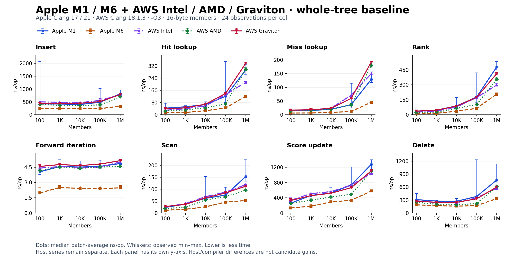
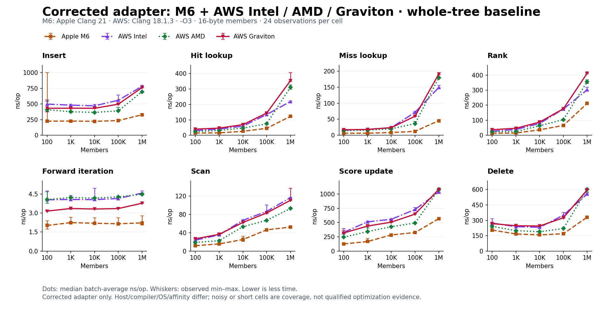
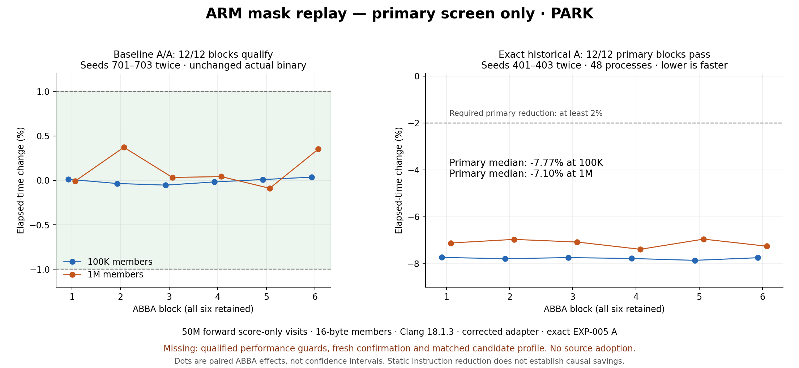
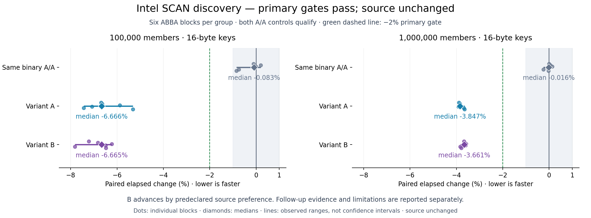
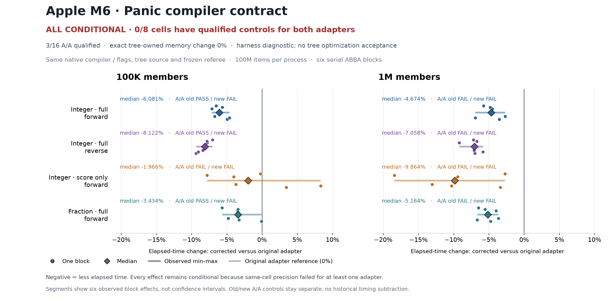
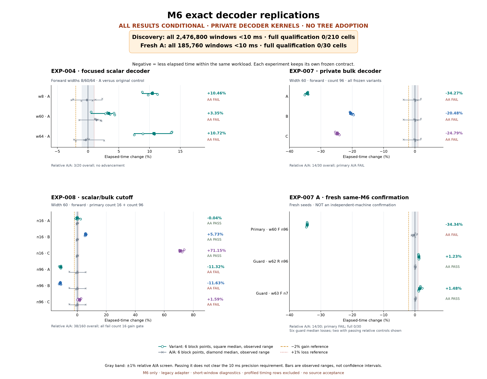
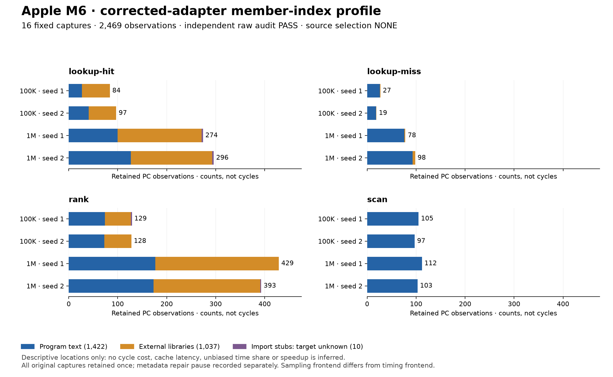
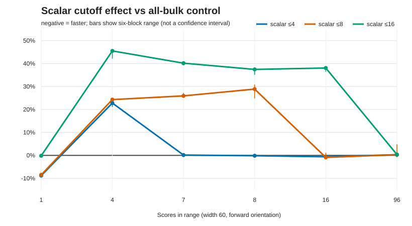

# Standalone B+ tree experiments

Microbenchmarks and optimization experiments for the packed B+ tree and compact
member index from [Redis PR #15635](https://github.com/redis/redis/pull/15635).
The data structure runs as a standalone C program; no Redis server is needed.

**Active follow-up:** the user authorized completing validation of the ARM mask lead.
The ARM-only lease is active until 11:15 Lisbon; fresh execution is being prepared.
The earlier overnight campaign and its handback remain complete. [Plan and activity](experiments/ARM-MASK-FOLLOWUP-001/README.md).
The candidate remains PARK pending the new controls, guards, confirmation and profile.

**Current state:** all five machines have completed the baseline matrix. Overnight
benchmark phases and fleet handback are complete; ARM is reserved again for the
follow-up above. M6's
final evidence handoff is published. No optimization
has been merged into `src/`; candidate patches and measured decisions live in `experiments/`.

The [shared overnight exploration plan](experiments/NIGHT-EXPLORATION-001/README.md)
tracks separate M1 and M6 host branches: rank, update paths, single-query lookup,
and decoder experiments. Both hosts have completed the **100 / 1K / 10K / 100K / 1M**
baseline. M1 now explicitly confirms reading M6's published decision at
06:50 UTC and records no further source experiment queued under the M6-priority
rule. Earlier DNS and write failures are historical; both hosts retain source NONE.
See the latest results and live status links below.

<!-- AWS-NIGHT-START -->
The **AWS Intel, AMD and Graviton campaign is complete**. All three OSS coordinators
are restored, verified after the **19 October, 09:00 Lisbon / 08:00 UTC** deadline.
[Morning report](experiments/NIGHT-EXPLORATION-001/AWS-MORNING-REPORT.md) ·
[Live handback proof](experiments/NIGHT-EXPLORATION-001/reviews/aws-release-final.json) ·
[Activity log](experiments/NIGHT-EXPLORATION-001/AWS-ACTIVITY.md).
Source adoption remains NONE; all candidate patches and decisions are retained.
<!-- AWS-NIGHT-END -->

AWS completed measured populations: **8 — 0 accepted / 5 rejected / 3 parked**.
Two additional ARM architecture replications are parked. Intel scan replication passed
both primary gates and fresh independent confirmation, but a qualified supplemental
guard regressed in all six blocks (+4.93% median); B is rejected, with no adoption.
AMD deletion and native ARM scan planning stopped before implementation because
precision controls failed; their independent proposals are retained. A separate
corrected-adapter ARM round completed qualified controls, three independent proposals
and three isolated NEON implementations. All three passed correctness but slowed
every primary block; the 144-run comparison is independently audited REJECT/NONE. Intel’s focused guards pass all 22 qualified cases; 14 noisy
controls and the original guard gaps remain unresolved. The supplemental failure
is decisive despite those earlier scoped gains. Corrected-source Intel controls now
qualify, but the separate known-guard A/A fails two of six blocks, so the corrected
replication is parked before candidate timing. AMD’s baseline score-only iterator
profile passes its controls; fresh100K A/A fails, preventing candidate work. ARM NEON follow-up
proposal review selected NONE despite qualified controls; all three proposals and
the conditional implementation dissent are retained. A separate corrected ARM score-only
iterator baseline qualified both sizes. Exact historical EXP-005 A then passed all
12 primary blocks (median elapsed−7.77% at100K,−7.10% at1M), after 570 validation
commands and independently reviewed codegen. This separate replication remains PARK:
qualified performance guards, fresh confirmation and matched profile are missing.
The two NONE proposal recommendations are retained; source adoption remains NONE.
AMD’s exact SSE2 replication under the corrected adapter failed the every-block2%
primary gate (medians−1.85%/−1.79% at100K/1M) and stopped with NONE.
[Decision ledger](experiments/NIGHT-EXPLORATION-001/AWS-DECISIONS.md) ·
[All24 retained patch records](experiments/NIGHT-EXPLORATION-001/AWS-PATCH-INDEX.md).

**Standalone adapter correction:** the panic declaration now conveys its existing
non-returning behavior. The reviewed C11 `_Noreturn` change preserves every assertion
and abort check; tree source and benchmark loops are unchanged.
[Independent reviews](https://github.com/redis-performance/bplus-tree-agent-workspace/blob/ce4a5e47c/experiments/NIGHT-EXPLORATION-001/runs/apple-m6-mini/20261019T013000Z/010-assertion-contract-review/README.md) and the
[fresh M6 baseline](https://github.com/redis-performance/bplus-tree-agent-workspace/blob/ce4a5e47c/experiments/NIGHT-EXPLORATION-001/runs/apple-m6-mini/20261019T013000Z/011-contract-baseline/RESULTS.md) pass correctness/raw audits.
Only **5/40 cells qualify**, and **14 have short windows**. The five-host chart below
retains the original adapter on every host; corrected-adapter rows have their own identity.
Separate corrected-adapter baselines are complete on all three AWS hosts:
**10/40 Intel**, **11/40 AMD** and **21/40 ARM** cases qualify. All seven validation
stages pass on each host. [New four-host chart](#corrected-adapter-baselines-m6-and-three-aws-architectures).
Earlier baselines and experiment decisions retain their original adapter identity.

## Active follow-up — guarded M6 lookup

[Shared session index](experiments/ACTIVE-SESSIONS.md) · [EXP-009 plan and live ownership](experiments/EXP-009/STATUS.md): a new, user-authorized follow-up investigates the scoped 100K lookup lead using the current corrected baseline and a semantic dispatch condition. PREPARING; no accepted optimization. All checkpoints and evidence publish on main for cross-session coordination.

## Build and test

Requires a C11 compiler (Clang or GCC), Make, and Python 3. Supports macOS and Linux.

```sh
git clone https://github.com/redis-performance/bplus-tree-agent-workspace.git
cd bplus-tree-agent-workspace
make -j2
make check
make sanitize
```

`make check` runs the upstream tree tests. `make sanitize` runs them in a separate
AddressSanitizer/UndefinedBehaviorSanitizer build.

## Run microbenchmarks

### Whole data structure

```sh
# All operations, with 100,000 members.
build/btree-bench --size 100000 --ops 1000000 --member-bytes 16 --seed 1

# One operation, saving CSV output.
build/btree-bench --case lookup-hit --size 100000 --ops 1000000 \
  --member-bytes 16 --seed 1 > lookup.csv
```

Available cases: `insert`, `lookup-hit`, `lookup-miss`, `rank`, `iterate`, `scan`,
`update`, and `delete`. CSV includes elapsed time, ns/op, operations/sec, tree-owned
memory, and a result checksum. Iteration and scan report time per visited member.
Use `make smoke` for a quick small-fixture check.

To run **all eight operations at 100, 1K, 10K, 100K and 1M members**, including build,
correctness checks, and repeated measurements:

```sh
python3 scripts/run-size-matrix.py --out scratch/size-matrix --budget-seconds 600
python3 scripts/analyse-size-matrix.py scratch/size-matrix
```

Use a new output directory each time. The [size-matrix guide](experiments/SIZE-MATRIX-001/README.md)
explains the workload and how to rerun it on another machine.

### Packed-score decoder

This smaller benchmark isolates score decoding for fast iterations: warmed fixtures,
repeated short batches, result checksums, and generated assembly for inspection.
It compares the original decoder with EXP-004's predicate change.

```sh
make decoder-check
make decoder-sanitize

# Use a new output directory for each run.
python3 scripts/run-decoder.py --out scratch/decoder-example
python3 scripts/analyse-decoder.py scratch/decoder-example
```

The runner saves raw samples and compares the baseline against itself to estimate
noise, then against the candidate. For bulk decoding and scalar/bulk cutoffs, use the
[latest experiment runbook](experiments/REPLICATE-LATEST.md).
See the [decoder guide](docs/DECODER-MICROBENCHMARK.md) and
[tree benchmark guide](docs/MICROBENCHMARKS.md) for measurement details.

## Latest results — Apple M1, M6 and three AWS architectures

### Whole-tree baseline: 100 / 1K / 10K / 100K / 1M members

All five hosts have completed all eight operations at all five sizes:
16-byte members, three seeds, six same-binary ABBA blocks, 120 serial processes
and 960 rows per host. Native and ASan/UBSan validations pass on all five hosts.

The chart overlays **Apple M1, Apple M6, AWS Intel, AWS AMD and AWS Graviton**
in each operation panel, with median batch-average **ns/op** and observed min–max
ranges. Each panel has its own y-axis. Lower is less time. All five series are
measured; AWS observations are pinned to CPU2, while the Apple runs were unpinned.



[Chart data, pinned source revisions and reproduction](experiments/NIGHT-EXPLORATION-001/baseline-charts/README.md).

Baseline values retain the pinned source revisions linked above. Optimization
status labels and the linked host logs are updated separately.

| Host | Compiler | Five-size baseline | Cells with >1% A/A variation | Optimization status / live updates |
|---|---|---|---|---|
| Apple M1 | Apple Clang 17, `-O3` | [Complete; 388.7s timing](https://github.com/redis-performance/bplus-tree-agent-workspace/blob/exploration/apple-m1-20261019T005019Z/experiments/NIGHT-EXPLORATION-001/runs/apple-m1/20261019T005019Z/001-baseline/matrix/SUMMARY.md) | 39/40 | [Count-one policies PARK; queue recorded closed; source NONE](https://github.com/redis-performance/bplus-tree-agent-workspace/blob/exploration/apple-m1-20261019T005019Z/experiments/NIGHT-EXPLORATION-001/runs/apple-m1/20261019T005019Z/STATUS.md) |
| Apple M6 | Apple Clang 21, `-O3` | [Complete; 162.42s timing](https://github.com/redis-performance/bplus-tree-agent-workspace/blob/exploration/apple-m6-mini-20261019T013000Z/experiments/NIGHT-EXPLORATION-001/runs/apple-m6-mini/20261019T013000Z/baseline-attempt002/SUMMARY.md) | 36/40 | [Five trials rejected; NEON blocked at controls; source NONE](https://github.com/redis-performance/bplus-tree-agent-workspace/blob/exploration/apple-m6-mini-20261019T013000Z/experiments/NIGHT-EXPLORATION-001/runs/apple-m6-mini/20261019T013000Z/STATUS.md) |
| Intel Sapphire Rapids (x86-64) | Clang18.1.3, `-O3`, CPU2 | [Complete; 338.54s timing](experiments/NIGHT-EXPLORATION-001/runs/aws-intel/20261019T020000Z/001-baseline/SUMMARY.md) | 27/40 | [Native worker: profiling and optimization](https://github.com/redis-performance/bplus-tree-agent-workspace/blob/exploration/aws-intel-20261019T020000Z/experiments/NIGHT-EXPLORATION-001/runs/aws-intel/20261019T020000Z/STATUS.md) |
| AMD Zen 5 (x86-64) | Clang18.1.3, `-O3`, CPU2 | [Complete; 325.44s timing](experiments/NIGHT-EXPLORATION-001/runs/aws-amd/20261019T020000Z/001-baseline/SUMMARY.md) | 30/40 | [Native worker: profiling and optimization](https://github.com/redis-performance/bplus-tree-agent-workspace/blob/exploration/aws-amd-20261019T020000Z/experiments/NIGHT-EXPLORATION-001/runs/aws-amd/20261019T020000Z/STATUS.md) |
| AWS Graviton / Neoverse V2 (arm64) | Clang18.1.3, `-O3`, CPU2 | [Complete; 377.83s timing](experiments/NIGHT-EXPLORATION-001/runs/aws-arm/20261019T020000Z/001-baseline/SUMMARY.md) | 19/40 | [Native worker: profiling and optimization](https://github.com/redis-performance/bplus-tree-agent-workspace/blob/exploration/aws-arm-20261019T020000Z/experiments/NIGHT-EXPLORATION-001/runs/aws-arm/20261019T020000Z/STATUS.md) |

Median batch-average **ns/op** from these overnight baselines; lower is less time.
Full five-size tables, observed ranges, raw rows and precision checks are linked above.

**100,000 members — ns/op**

| Operation | Apple M1 | Apple M6 | AWS Intel | AWS AMD | AWS Graviton |
|---|---:|---:|---:|---:|---:|
| Insert | 489.02 | 239.51 | 557.98 | 385.01 | 512.41 |
| Hit lookup | 121.26 | 44.66 | 132.10 | 71.40 | 139.87 |
| Miss lookup | 36.60 | 12.14 | 71.19 | 35.72 | 59.57 |
| Rank | 178.24 | 64.92 | 173.68 | 103.67 | 175.64 |
| Forward iteration | 4.58 | 2.39 | 4.51 | 4.51 | 4.81 |
| Scan | 75.24 | 46.06 | 87.61 | 68.40 | 84.27 |
| Score update | 733.07 | 332.67 | 734.98 | 492.17 | 665.28 |
| Delete | 383.79 | 170.91 | 354.05 | 220.36 | 328.82 |

**1,000,000 members — ns/op**

| Operation | Apple M1 | Apple M6 | AWS Intel | AWS AMD | AWS Graviton |
|---|---:|---:|---:|---:|---:|
| Insert | 814.90 | 335.40 | 779.74 | 700.16 | 787.01 |
| Hit lookup | 293.74 | 121.45 | 213.14 | 296.79 | 336.90 |
| Miss lookup | 128.65 | 45.60 | 149.40 | 179.61 | 191.78 |
| Rank | 480.32 | 208.22 | 297.65 | 355.49 | 412.77 |
| Forward iteration | 4.86 | 2.47 | 5.01 | 4.59 | 5.14 |
| Scan | 153.10 | 52.09 | 118.96 | 95.60 | 112.40 |
| Score update | 1277.59 | 577.93 | 1039.10 | 1099.21 | 1104.32 |
| Delete | 763.82 | 334.02 | 571.45 | 611.89 | 601.81 |

These are separate host baselines with different compilers and machine conditions.
Their differences are not candidate optimization gains. A/A variation and short
windows require targeted qualification before small performance claims; no tree
optimization has been adopted. Each candidate must beat its own host's baseline.

The [earlier M1 preparation results](experiments/SIZE-MATRIX-001/apple-m1-five-sizes/SUMMARY.md)
and [chart](experiments/SIZE-MATRIX-001/apple-m1-five-sizes/size-matrix.svg) remain
separate from these overnight baselines. [Baseline plan and rerun commands](experiments/SIZE-MATRIX-001/README.md).

### Corrected-adapter baselines: M6 and three AWS architectures

All four hosts pass native/sanitizer validation and independent raw reconstruction.
This chart uses the corrected panic adapter on every host; the original five-host
chart above keeps its original identity. There is no corrected M1 series.



| Host | Qualified cases | Short windows | Other noisy cases |
|---|---:|---:|---:|
| Apple M6 | 5/40 | 14/40 | 21/40 |
| AWS Intel | 10/40 | 11/40 | 19/40 |
| AWS AMD | 11/40 | 11/40 | 18/40 |
| AWS Graviton | 21/40 | 11/40 | 8/40 |

These outcome columns are disjoint. Qualification requires all six A/A blocks within
±1% and windows of at least 10 ms. Machine/compiler/OS/affinity differences are not
candidate gains. [Exact data, 100K/1M tables, source parity and reproduction](experiments/NIGHT-EXPLORATION-001/corrected-adapter-charts/README.md).

### ARM historical mask replay: primary lead, parked

Exact EXP-005 A produced **7.77% /7.10% lower median elapsed time** at100K/1M in
forward score-only iteration on AWS NeoverseV2. All12 paired blocks passed; outputs,
owned memory and frozen identities match. This is a historical architecture replay,
not a new population or general tree speed claim. **PARK; no source adoption:**
qualified mixed-output and broader guards, fresh confirmation and a matched candidate
profile are missing. The4→3 static mask instruction change does not establish the
cause of the larger measured improvement.
[Root raw audit](experiments/NIGHT-EXPLORATION-001/reviews/aws-arm-mask-screen-independent-audit.json) ·
[Independent review](https://github.com/redis-performance/bplus-tree-agent-workspace/blob/16f074fbe/experiments/NIGHT-EXPLORATION-001/runs/aws-intel/20261019T020000Z/025-arm-mask-raw-review/REVIEW.md).



### Intel scan replication: rejected after a qualified guard regression

**Current original-adapter decision: REJECT/NONE.** The supplemental trim guard
with319-byte members and alternating signed-zero scores regressed in all six qualified
blocks (+4.93% median). That failure is decisive despite earlier primary gains.
[Supplemental raw audit](experiments/NIGHT-EXPLORATION-001/reviews/aws-intel-supplemental-independent-audit.json).
The separate corrected-adapter replay is PARK before candidate timing because its
known-guard controls failed; it does not reverse this original-adapter rejection.

Earlier independent confirmation on Intel measured **6.78% lower scan elapsed time at 100K
members and 3.66% at 1M**. All 12 confirmation blocks passed the 2% gate with qualified
controls and unchanged results and memory. [Confirmation audit](experiments/NIGHT-EXPLORATION-001/reviews/aws-intel-scan-confirmation-raw-audit.json).

Both A and B passed the earlier discovery screen. B advanced under the predeclared
source-maintenance preference; no A-versus-B speed superiority is claimed. The chart
below preserves that discovery checkpoint.

At the earlier discovery/guard checkpoint, the decision was PARK. Of57 cases with
qualified controls,56 passed every
original guard block. One small iteration case has mixed effects, including +1.33%.
Another 23 cases have short or noisy controls, leaving **24 of 80 cases unresolved**.
[Independent guard audit](experiments/NIGHT-EXPLORATION-001/reviews/aws-intel-original-guards-independent-summary.json).
Matched profiles provide directional support, strongest at 1M; the 100K sample gap
is too coarse for a precise explanation. Separate focused guards pass all 22
qualified cases; 14 noisy controls remain unresolved.
[Independent focused review](experiments/NIGHT-EXPLORATION-001/reviews/aws-intel-focused-independent-summary.json).
[Profile review](experiments/NIGHT-EXPLORATION-001/reviews/aws-intel-matched-profile-independent-summary.json).
The tree source stays unchanged.
[Independent raw audit](experiments/NIGHT-EXPLORATION-001/reviews/aws-intel-scan-raw-audit.json),
[decision and limitations](experiments/NIGHT-EXPLORATION-001/AWS-DECISIONS.md),
[independent adversarial review](https://github.com/redis-performance/bplus-tree-agent-workspace/blob/27fed33a7/experiments/NIGHT-EXPLORATION-001/runs/aws-amd/20261019T020000Z/010-intel-scan-review/ADVERSARIAL-REVIEW.md).



### M6 campaign decisions

[The first M6 rank population](https://github.com/redis-performance/bplus-tree-agent-workspace/blob/exploration/apple-m6-mini-20261019T013000Z/experiments/NIGHT-EXPLORATION-001/runs/apple-m6-mini/20261019T013000Z/002-rank/RESULTS.md)
rejects all three shorter-side summation implementations: the 100K primary took
about 3.4–3.9% longer by median block effect. The 1M signals remain inside A/A noise.
Source stays unchanged. [M6 update repacking](https://github.com/redis-performance/bplus-tree-agent-workspace/blob/exploration/apple-m6-mini-20261019T013000Z/experiments/NIGHT-EXPLORATION-001/runs/apple-m6-mini/20261019T013000Z/003-update/RESULTS.md) also fails its 100K primary; its 1M reductions remain exploratory. [M6 lookup physical-score decoding](https://github.com/redis-performance/bplus-tree-agent-workspace/blob/exploration/apple-m6-mini-20261019T013000Z/experiments/NIGHT-EXPLORATION-001/runs/apple-m6-mini/20261019T013000Z/004-lookup/RESULTS.md) has a 100K-only exploratory lead but no dual-primary winner. The population steps were
sequential passes, with all patches preserved.

[M6 count-one decoder policies](https://github.com/redis-performance/bplus-tree-agent-workspace/blob/exploration/apple-m6-mini-20261019T013000Z/experiments/NIGHT-EXPLORATION-001/runs/apple-m6-mini/20261019T013000Z/005-decode/RESULTS.md) retain a roughly30% private count-one lead, but repeated qualified guard losses reject all three universal policies. Baseline source stays unchanged.

[Call-boundary lookup follow-up](https://github.com/redis-performance/bplus-tree-agent-workspace/blob/exploration/apple-m6-mini-20261019T013000Z/experiments/NIGHT-EXPLORATION-001/runs/apple-m6-mini/20261019T013000Z/006-followup/RESULTS.md) also rejects all three implementations: A's qualified100K lead is−2.71%, while no variant clears both100K/1M gates. Three actual independent agents completed both population stages. Baseline source stays unchanged.


The [matched adapter diagnostic](https://github.com/redis-performance/bplus-tree-agent-workspace/blob/7c8f5c0bd/experiments/NIGHT-EXPLORATION-001/runs/apple-m6-mini/20261019T013000Z/012-contract-diagnostic/RESULTS.md)
compares the truthful panic compiler contract in the same session:576processes,
identical source/referees and owned memory. Integer full-output forward/reverse
medians are−6.08%/−8.12% at100K and−4.67%/−7.06% at1M. **All effects remain
conditional:** zero workloads qualify controls for both adapters. The independent
raw audit passes; this harness diagnostic accepts no tree optimization.



The [exact M6 decoder replications](https://github.com/redis-performance/bplus-tree-agent-workspace/blob/a9df242d4c0b68c4c1bc6482a155f7d16c199a7f/experiments/NIGHT-EXPLORATION-001/runs/apple-m6-mini/20261019T013000Z/018-decoder-replications/RESULTS.md) completed
**20,640 serial processes and 2,662,560 measured batches**, with independent raw
audits. EXP-007 A's private full-leaf median repeats at−34.34% on fresh seeds, but
failed controls and guard losses keep it PARK. EXP-008 fails its count16 gain gates.
**Every individual window is below10ms**: full qualification is0/210 discovery
cells and0/30 fresh cells. No tree optimization is adopted. The original expanded
EXP-008 correctness matrix also passes16,512 native/sanitizer cells.



The [corrected-adapter member-index profile](https://github.com/redis-performance/bplus-tree-agent-workspace/blob/366431702/experiments/NIGHT-EXPLORATION-001/runs/apple-m6-mini/20261019T013000Z/020-member-index-profile-continuation/RESULTS.md)
now accounts for **16 captures and 2,469 observations**, with independent raw audit:
1,422 in program text, 1,037 in external libraries and 10 import-stub observations
with targets kept unknown. Scan's inlined tag-matching ranges contain 184 observations; rank already
vectorizes its child-count reduction. These are sampled locations, not cycle costs.
The initial metadata failure and separate repair are preserved; no capture was
repeated. The resulting three-proposal review is complete; source remains NONE.



The [exact corrected NEON attempt](https://github.com/redis-performance/bplus-tree-agent-workspace/blob/8bcd75d704eae2b4f45131531a3d8177cb852c09/experiments/NIGHT-EXPLORATION-001/runs/apple-m6-mini/20261019T013000Z/023-neon-replication/RESULTS.md)
passes 141 validation commands and independent audits. All 48 fresh M6 baseline
controls complete, but **1M fails two blocks: −1.467% and +1.641%** against the
fixed ±1% gate. The 100K control qualifies in all six blocks; all windows exceed
223 ms. **PARK before candidate timing:** no NEON speed result, retry or count
change. The original three patches and authors remain unchanged.


The [final M6 evidence report](https://github.com/redis-performance/bplus-tree-agent-workspace/blob/85afa6c7b798130452ca9dbd63082337e8bd78b7/experiments/NIGHT-EXPLORATION-001/runs/apple-m6-mini/20261019T013000Z/MORNING-REPORT.md)
links the decisions, raw audits and limits. Experiments stopped before the 08:15 Lisbon
cutoff; final reporting closed at 09:01 Lisbon. The
[final handoff receipt](https://github.com/redis-performance/bplus-tree-agent-workspace/blob/85afa6c7b798130452ca9dbd63082337e8bd78b7/experiments/NIGHT-EXPLORATION-001/runs/apple-m6-mini/20261019T013000Z/FINAL-HANDOFF.json)
records source identities and M1's confirmed consumption of the M6 decisions.
The later ARM packed-score-mask result remains an untested future M6 lead.

M6 branch totals (AWS and concurrent M1 night separate): **12 populations; 0 accepted / 7 rejected / 5 parked;
36 retained patches; 15 validated harnesses**. [Chart data and pinned reproduction](experiments/NIGHT-EXPLORATION-001/latest-charts/README.md).

### Decoder experiments

The [new M1 night checkpoint](https://github.com/redis-performance/bplus-tree-agent-workspace/blob/de50258803062e4803f2a030effff1ce428d74ee/experiments/NIGHT-EXPLORATION-001/runs/apple-m6-mini/20261019T013000Z/025-m1-receipt/README.md)
adds 6,720 count-one trial processes and 866,880 sample rows, independently
verified from its archived outputs. All 70 A/A cells miss the 10 ms gate;
private leads and guard losses remain exploratory. M1 records **PARK / source
NONE** and nine total populations with mixed inherited provenance. Its ledger
is kept separate from M6; these totals are not summed.
The [post-round gate check](https://github.com/redis-performance/bplus-tree-agent-workspace/blob/a902bddefae8e3c6a6a165712d7e0037368b2c0e/experiments/NIGHT-EXPLORATION-001/runs/apple-m6-mini/20261019T013000Z/026-m1-gate-confirmation/README.md)
confirms M1 consumed the M6 decision and queued no further source trial.

The decoder results below were measured on **Apple M1**, using Apple Clang 17,
`-O3`, and one unpinned thread. They isolate packed-score decoding; their gains
are not whole-tree speedups. The completed M6 replications are shown above and
retain separate rows, compiler identity and controls.

| Experiment | What we learned | Outcome |
|---|---|---|
| [EXP-004: simpler scalar predicate](experiments/EXP-004/decoder-microbench-2026-10-19/README.md) | Decoding took about 16% longer for 8-bit scores and 10% longer for 64-bit scores. | No general decoder improvement. |
| [EXP-007: specialized bulk decoder](experiments/EXP-007/RESULTS.md) | For 96 scores, decode time fell 33% at 60 bits and about 43% at 8/64 bits versus the scalar output loop. Three short-range cases regressed. | Promising for bulk work; not adopted. |
| [EXP-008: scalar fallback for short ranges](experiments/EXP-008/RESULTS.md) | Switching to scalar at cutoffs of 4, 8, or 16 scores introduced substantial short-range regressions versus the bulk decoder. | None of the three cutoffs selected. |

The latest chart compares those three cutoffs with **EXP-007's bulk decoder** at
60-bit score width, forward direction. Below zero means less time; above zero means
more time. Bars show the observed range across measurement blocks.



The next hypothesis is a scalar fallback **only for a single score**. That policy
has not been tested yet. The complete [experiment log](experiments/EXPERIMENTS.md)
retains earlier attempts and their evidence.

For **Apple M6 decoder** reruns, follow the
[replication instructions](experiments/REPLICATE-LATEST.md). Save those results
separately from M1; the completed M6 whole-tree baseline is linked above.

## How optimization decisions work

Each experiment starts with profiling, then uses two population-based steps:

1. **Choose the idea:** three independent proposals examine the same baseline and
   profiles. A chair selects one hypothesis, or none, and records the reasons.
2. **Choose the implementation:** three isolated implementations compete on correctness
   and serial benchmarks. A candidate needs fresh confirmation, profiling, and review
   before adoption. If none passes, keep the baseline.

When independent agents are unavailable, record sequential passes explicitly.
Full procedure: [population protocol](docs/POPULATION.md).

## Code and documentation

- [`src/`](src/): B+ tree and compact member index.
- [`bench/`](bench/) and [`tests/`](tests/): microbenchmarks and correctness checks.
- [`experiments/`](experiments/): candidate patches, reports, profiles, and raw results.
- [`compat/`](compat/) and [`vendor/redis/`](vendor/redis/): standalone adapter and required upstream support.
- [Source manifest](source-manifest.json), [extraction notes](docs/STANDALONE.md), and [licensing](NOTICE.md).
