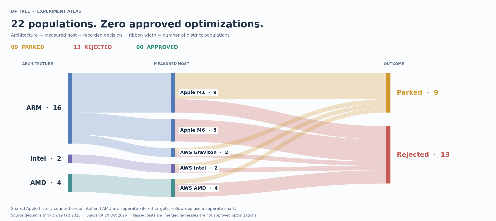

# Standalone B+ tree experiments

Packed B+ tree and compact member-index benchmarks from [Redis PR #15635](https://github.com/redis/redis/pull/15635). Standalone C; no Redis server.

**34 experiment attempts: 18 parked · 16 rejected · 0 approved.**
ARM 24 · Intel 5 · AMD 5. Includes 22 new populations, 5 replications and 7 qualification attempts; shared Apple history counted once. Tree source unchanged.



**Experiment flows:** [All experiments](experiments/EXPERIMENT-FLOWS-20261020/all-attempts.svg) · [ARM](experiments/EXPERIMENT-FLOWS-20261020/arm.svg) · [Intel](experiments/EXPERIMENT-FLOWS-20261020/intel.svg) · [AMD](experiments/EXPERIMENT-FLOWS-20261020/amd.svg) · [Follow-ups](experiments/EXPERIMENT-FLOWS-20261020/followups.svg) · [Evidence ledger](experiments/EXPERIMENT-FLOWS-20261020/README.md)

## What matters

**Intel follow-ups:** exact libc hotspots resolved; fresh secondary-host diagnostics prepared. The earlier sweep has [ownership and annotation corrections](experiments/INTEL-PARKED-PROFILES-001/CORRECTIONS-20261020.md). [Current work](experiments/INTEL-FOLLOWUP-001/README.md).

- **ARM mask:** primary gains survived, but qualified guards regressed. [Rejected](experiments/ARM-MASK-FOLLOWUP-001/RESULTS.md).
- **Intel scan:** primary gains and confirmation passed; a qualified guard regressed. [Rejected replication](experiments/NIGHT-EXPLORATION-001/runs/aws-intel/20261019T020000Z/014-scan-supplement/README.md).
- **AMD scan / Apple decoder leads:** unresolved controls or guards prevent adoption. [Decisions](experiments/EXPERIMENT-FLOWS-20261020/README.md).
- **Latest M6 lookup:** clock-bracket harness validated; 1M precision still fails. [Parked](experiments/M6-CLOCK-BRACKET-001/RESULTS.md).

## Run

C11 compiler, Make and Python 3; macOS or Linux.

```sh
make -j2
make check
make sanitize
build/btree-bench --size 100000 --ops 1000000 --member-bytes 16 --seed 1
```

[Tree benchmark guide](docs/MICROBENCHMARKS.md) · [Decoder guide](docs/DECODER-MICROBENCHMARK.md) · [Five-size matrix](experiments/SIZE-MATRIX-001/README.md)

## Evidence and rules

[Five-host baselines](experiments/NIGHT-EXPLORATION-001/baseline-charts/README.md) · [Corrected-adapter baselines](experiments/NIGHT-EXPLORATION-001/corrected-adapter-charts/README.md) · [Experiment log](experiments/EXPERIMENTS.md) · [Summary](experiments/SUMMARY.md)

Acceptance requires correctness, qualified controls and guards, profiles, fresh confirmation and independent review. [Population protocol](docs/POPULATION.md) · [Required performance MCP workflow](docs/PERFORMANCE-MCP.md)

[Source](src/) · [Tests](tests/) · [Source manifest](source-manifest.json) · [Extraction notes](docs/STANDALONE.md) · [Licensing](NOTICE.md)
