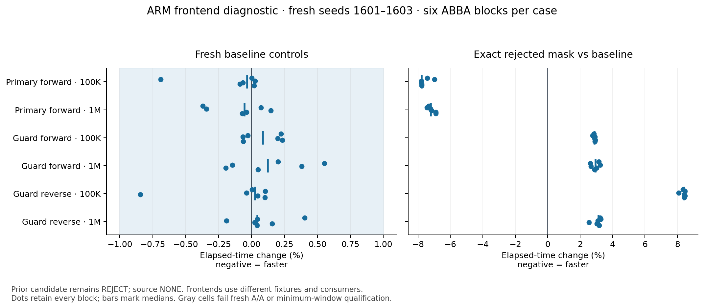

# ARM frontend diagnostic — final result

The diagnostic is complete. Fresh native timings reproduce the primary gains and
four guard regressions. Instrumented copies retire fewer instructions in all18
matched fixtures, but failed instrumentation and strict code-mapping controls block
transfer to the actual timing binaries. **The native causal explanation remains
INCONCLUSIVE; the candidate remains REJECT, source NONE.** No optimization is adopted.
The ARM OSS coordinator is restored and independently verified; no runner work is queued.

## Fresh native controls

Exact historical binaries, CPU2, seeds1601–1603 repeated twice, six ABBA blocks per
cell. All144 processes completed in91.589 seconds. Root verified297 sealed files,
exact source/binary identities, checksum and tree-owned memory joins, and the
separate post-run idle proof. Intel independently reconstructed the same outcome.

| Frontend / direction / size | Largest absolute A/A effect | Shortest window | Qualification |
|---|---:|---:|---|
| primary-forward-100000 | 0.690% | 166.363 ms | PASS |
| primary-forward-1000000 | 0.369% | 186.611 ms | PASS |
| h4-forward-100000 | 0.233% | 64.721 ms | PASS |
| h4-forward-1000000 | 0.552% | 72.563 ms | PASS |
| h4-reverse-100000 | 0.844% | 62.676 ms | PASS |
| h4-reverse-1000000 | 0.403% | 74.581 ms | PASS |

[Root raw audit](NATIVE-AA-ROOT-AUDIT.json) ·
[Immutable operator evidence](https://github.com/redis-performance/bplus-tree-agent-workspace/tree/70103fb6a/experiments/NIGHT-EXPLORATION-001/runs/aws-arm/20261019T020000Z/030-frontend-diagnosis).

## Exact native comparison

Same-session baseline/A ABBA with the same fresh seeds and exact historical binaries.
All 144 comparison runs completed; root and independent Intel06a776000 reconstructed
every row, baseline join, checksum, tree-owned memory and source/binary identity.
The separate post-run check found the runner idle with protected identities intact.

| Frontend / direction / size | Median elapsed change | All six blocks | Qualified A/A |
|---|---:|---|---|
| primary-forward-100000 | -7.775% | -7.786% to -6.972% | PASS |
| primary-forward-1000000 | -7.194% | -7.455% to -6.896% | PASS |
| h4-forward-100000 | +2.903% | +2.770% to +2.943% | PASS |
| h4-forward-1000000 | +2.953% | +2.628% to +3.245% | PASS |
| h4-reverse-100000 | +8.431% | +8.077% to +8.473% | PASS |
| h4-reverse-1000000 | +3.141% | +2.552% to +3.277% | PASS |

Negative means faster; positive means slower. These are scoped frontend comparisons,
not an architecture ranking or a causal explanation.

[Comparison raw audit](NATIVE-COMPARISON-ROOT-AUDIT.json) ·
[Independent comparison review](https://github.com/redis-performance/bplus-tree-agent-workspace/blob/06a776000/experiments/NIGHT-EXPLORATION-001/runs/aws-intel/20261019T020000Z/031-arm-native-raw-review/native-comparison-121e9643a/REVIEW.md).

## Interpretation limits

The primary and guard frontends have different score distributions, checksum
consumers, warm-up, allocation histories and requested visits. Their effects are
reported separately. Assembly confirms the guard's mask selection already occurs
outside its repeated loop; this rules out that particular per-visit branch premise,
not the other possible causes. Actual IteratorNext bodies contain114 instructions
in control and113 in the candidate; static counts do not measure dynamic work.

The completed profile tests the direction in18 paired fixtures. Scope controls
pass and every instrumented pair reduces instructions, supporting that direction
only for these instrumented copies. The original-binary explanation is inconclusive:
only2/12 source/cell instrumentation controls qualify, with no complete control/A
pair, and the preregistered strict tree-code mapping gate fails. No favorable
counter direction waives the qualified native guard regressions.

The [actual cpu-perf MCP consultation](CPU-PERF-CONSULTATION.json) returned reference
leads but no source passages; the Arm manual was unavailable to its fetcher. Its
heuristic metadata audit is not a replacement for raw-data verification. Frequency,
DVFS/turbo and SMT observations during these windows remain unknown. No vendor
mechanism or portable performance claim is inferred from these results.

## Completed matched profiles

Immutable operator [266360cfb](https://github.com/redis-performance/bplus-tree-agent-workspace/tree/266360cfbea81808a05c0570453dd4d68b182e7e/experiments/NIGHT-EXPLORATION-001/runs/aws-arm/20261019T020000Z/030-frontend-diagnosis)
contains642 serial commands,415.038seconds inside the1,200second cap,36 scientific
cycle captures and36 scientific counter runs, plus all frozen controls. Four original
43-test suites, native/sanitizer semantics and within-allocator tree-memory checks
pass. All18 paired instruction changes are negative (−1.77718% to−1.74449%).

| Instrumented frontend / size | Median instructions change | Median cycles change |
|---|---:|---:|
| Primary forward100K | −1.744826% | −4.464473% |
| Primary forward1M | −1.744558% | −2.107274% |
| H4 forward100K | −1.744717% | −1.312874% |
| H4 forward1M | −1.744571% | −1.252321% |
| H4 reverse100K | −1.776219% | −1.736474% |
| H4 reverse1M | −1.775970% | −2.379263% |

Cycles decreased in17/18 pairs; the remaining H4forward1M pair increased0.048146%.
Branch-miss changes were mixed; no unfavorable direction was removed.
Each row summarizes three matched seeds; all per-run counter directions remain in
[the independent root reconstruction](PROFILE-ROOT-AUDIT.json). These descriptive
counter medians are neither qualified native timing gains nor a causal decomposition.
Counters are unscaled; runtime qualification uses perf's rounded100.00% report,
not exact enabled/running nanosecond equality. No capture was retried or excluded.

The36 scientific captures contain3,395 physical samples and9,940,917,026 sampled
period units, with zero reported losses. The positive scope control places234of238
samples inside known work and none in outside work. The deliberately missing-disable
control exposes241outside-work samples of478, so that fault is detected. Disabled
counter controls retain zero/not-counted events. Scope validity passes separately
from code mapping and timing transfer.

Strict mapping credits1,685of1,837 tree samples. All152 uncredited samples land at
IteratorNext entry offsets0/4/8: their isolated instruction words match, but the
frozen centered seven-word rule cannot extend before function entry and the whole
function differs elsewhere. This is a mapping-rule limitation, **not evidence that
those entry words changed**. The gate remains failed; no post-result edge exception
is added. Unknown/unmatched caller records remain, and coarse caller buckets cannot
isolate checksum/conversion cost.

Only candidate primary1M and control H4reverse100K pass their own instrumentation
controls. Thus **zero of six frontend/size pairs qualify both sources for timing
transfer**. Census summaries, assembly, raw streams, unsuccessful controls and all
38 original perf.data checksums are retained; large raw perf.data stays local.
Public text removes operational prefixes/hostnames through explicit dual-hash
publication records. Root's initial metadata-adapter failures are preserved in
[the audit correction record](PROFILE-ROOT-AUDIT-INITIAL.json).

## Decision and handback

No new proposal/implementation population was run. Historical AWS totals remain
**8 populations:0accepted /5rejected /3parked**, with24retained variants. Baseline
target source is unchanged. The exact mask remains rejected; no upstream action.
A future attempt to isolate the frontend discrepancy needs a separate preregistered
experiment and qualified instrumentation; this run supplies no new accepted mechanism.

The owned release script ran at11:24:28UTC while its independent timer was armed.
[Fresh live proof](RELEASE-FINAL.json) at11:24:35–37UTC verifies OSSRUNNING with
matching saved/livePID, fresh marker, inactive slice and zero owned units/processes,
with no inspection errors. The timer was stopped after successful release; the
pending read-only auditor was cancelled only after live proof. Private fleet status
is RELEASED; Intel/AMD remained released throughout this ARM-only diagnostic.

The mandatory MCP workflow was actually used and [reconsulted on these results](CPU-PERF-PROFILE-FOLLOWUP.json).
Its library still had no indexed supporting passages; unread leads are not evidence.
Neither consultation changed a frozen gate or supplied a causal explanation.

## Independent reviews

[Intel raw reconstruction](https://github.com/redis-performance/bplus-tree-agent-workspace/blob/16118f441/experiments/NIGHT-EXPLORATION-001/runs/aws-intel/20261019T020000Z/033-arm-profile-raw-review/result-266360cfb/REVIEW.md)
and [AMD adversarial review](https://github.com/redis-performance/bplus-tree-agent-workspace/blob/f1ffd7e1741a036b8a5de0a6d5d4f430f205ddd2/experiments/NIGHT-EXPLORATION-001/runs/aws-amd/20261019T020000Z/035-arm-dual-frontend-diagnostic-review/PROFILE-RESULT-ADVERSARIAL-REVIEW-266360.md)
independently reproduce the raw scope/counter and strict mapping results without
producer imports. Both retain the failed transfer gates and reject a native causal
claim. The root audit separately reconstructs contracts, rows, counters, census,
source identities and instrumentation arithmetic. Reviews use public decoded streams
and raw/public hash receipts; large original perf.data was not independently reparsed.
Actual participants are root/ARM operator/Intel reviewer/AMD reviewer; exact serving
models and token/currency costs remain unknown.
