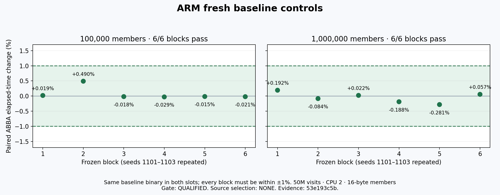

# ARM mask follow-up — 19 October 2026

Status: primary gain reproduced (−7.78% / −7.21% elapsed); original comparison has 17 qualified passes and one mixed SCAN; iterator controls qualify43/82 and the fixed comparison is granted. [Current results](RESULTS.md). The user authorized completing validation of the existing ARM
mask lead after the overnight handback, including Git publication. This is a new,
bounded ARM-only runner lease, ending no later than 10:15 UTC (11:15 Lisbon), with
early release on completion. Intel and AMD runners remain released.

## Fixed candidate and prior evidence

Continue exact historical EXP-005 A; no source retuning, alternative candidate or new
population. Corrected referee source is `13e459ff8800be3f02b6b45c87dd7b0c39453fa9`.
The exact patch SHA-256 is
`ca14579cbf4325816d5511697cb0bec5ab0e618ef661830acbc4bfe72a5cc88f`;
candidate C SHA-256 is
`aa834a771284bed367400a8f54538cd366b2791666d9711a8e160aaa93f62fc4`.
Prior actual baseline binary SHA-256 is
`330b39a991573985c421194cfe83f21b44797e1a83372f623120672eb910b3bc`;
prior candidate binary SHA-256 is
`b1cb9e4b2a1df204a75b4b4a3264364c3f0b5b46dbf475bae72c3c9a3ee5811d`.
Existing binaries, raw results and release records are preserved and rechecked.

The prior ARM primary screen (`6bcd8e575`) passed all 12 blocks, with median elapsed
changes of −7.766545% / −7.101923% at 100K / 1M members. Its status remains PARK.
The old A/A qualification does not qualify this new session. Earlier proposals,
including two NONE recommendations, and historical EXP-005 PARK remain preserved.

## Required execution gates

1. Recheck exact source/referee/compiler/flags/allocator, binaries and host identity.
2. Freeze the fresh-session schedule and full performance-guard coverage, then obtain
   independent review before running. Use the same forward score-only primary,
   16-byte members and 50M visits; six paired ABBA blocks at each size.
3. Qualify new A/A controls and measure same-session comparisons serially on CPU 2.
   Every primary block must improve at least 2%; guard or owned-memory regressions
   above 1% prevent acceptance. Minimum windows 10ms; unresolved noise means PARK.
4. Cover mixed/no-output, reverse, encoding/length and shared-decoder operations.
   Retain failures and all per-run rows; no retry or post-result threshold tuning.
5. If eligible, an independent operator performs frozen held-out confirmation on the
   same ARM host, with fresh A/A and exact candidate/baseline identities.
6. Collect matched candidate/control profile evidence and complete adversarial review.
   Static instruction counts alone do not explain the measured timing difference.

ARM prepares and operates the guarded continuation; AMD reviews execution and semantics;
Intel prepares and, if eligible, operates independent confirmation. Root controls the
lease and execution grants. Existing agent identities and prior authorship are disclosed
in their records; exact serving model/token/currency costs remain unknown.

All timing uses a dedicated runner and bounded owned systemd jobs. An independent
release timer restores the OSS coordinator; actual release requires live proof. No
Redis integration or upstream action is authorized. Acceptance requires every gate;
otherwise record REJECT or PARK and keep the baseline source unchanged.

## Evidence

- [Previous overnight report](../NIGHT-EXPLORATION-001/AWS-MORNING-REPORT.md)
- [Previous independent raw audit](../NIGHT-EXPLORATION-001/reviews/aws-arm-mask-screen-independent-audit.json)
- [Previous chart](../NIGHT-EXPLORATION-001/latest-charts/aws-arm-mask-primary.png)
- Fresh execution freezes, reviews, results and the decision will be linked here as published.

## Fresh control evidence

All12 blocks qualify within±1%; no candidate result is claimed by these controls.
[Root raw audit](PRIMARY-AA-ROOT-AUDIT.json) · [Independent review](https://github.com/redis-performance/bplus-tree-agent-workspace/blob/f9daaf4e3/experiments/NIGHT-EXPLORATION-001/runs/aws-amd/20261019T020000Z/034-arm-mask-continuation-review/FRESH-PRIMARY-AA-REVIEW-53e193c5b.md).

