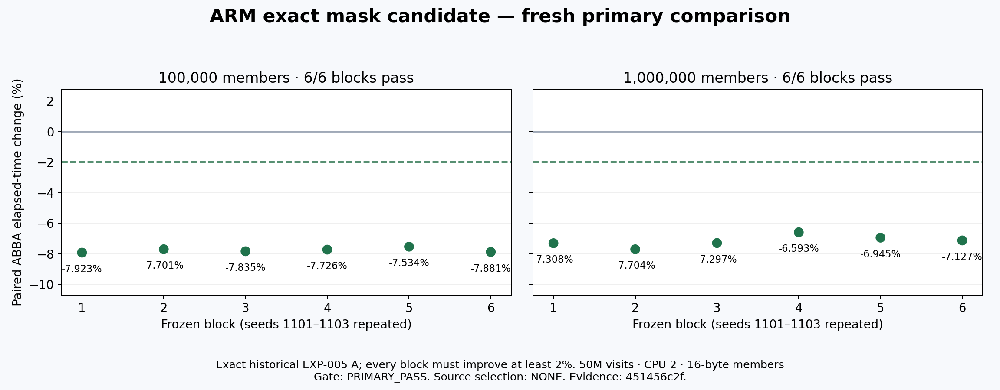
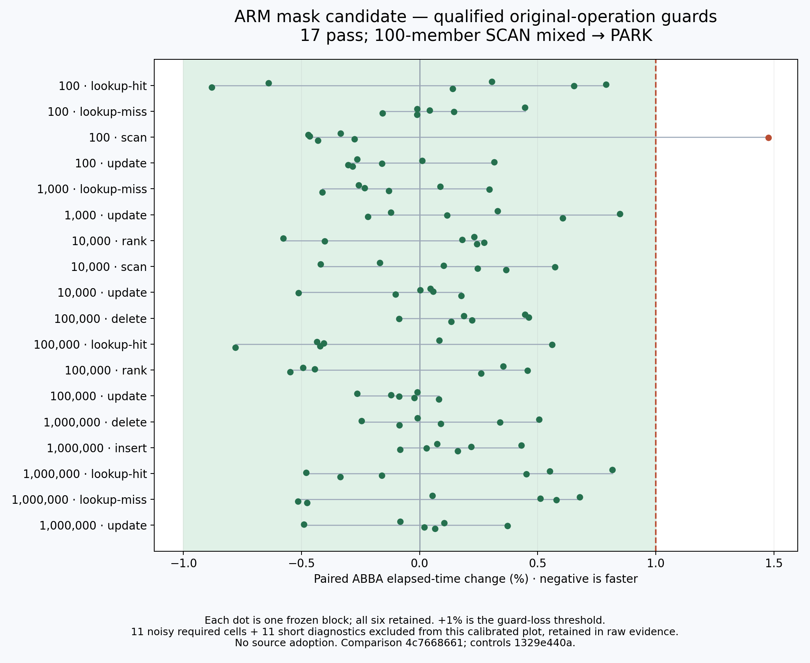

# ARM mask follow-up — final result

**REJECT / source NONE.** The primary benchmark repeats a7–8% elapsed-time reduction,
but nine qualified iterator guard cases regress in every one of six blocks. Their
median slowdowns range from **+2.860% to +8.519%**, exceeding the preregistered1% guard
limit. Root and independent Intel raw audits agree. No optimization was adopted.

All six frozen timing phases completed: **4,272 processes /5,952 rows**. The original
failed correctness attempt and its separate six-command closure remain preserved.
Matched profiling and independent held-out confirmation were **not run** after the
decisive rejection. The ARM runner was released early: live OSS restoration verified
at **10:03:25–10:03:27 UTC /11:03 Lisbon**, before the10:15UTC hard deadline.
[Release proof](RELEASE-FINAL.json) · [Decision data](FINAL-DECISION.json).

## Decisive iterator guards

Comparison `f30ac4330` completes all1,968 processes /492 ABBA blocks in762.891763seconds.
Its controls `8ed45423c` qualify43/82required cases;39 fail precision,none are short.
Among the43qualified comparisons: **9REJECT /30PASS /4mixedPARK**. Every rejected case
is score-only output(mask4),16-byte members,20M visits and three warm-up passes under
HARNESS-004. All output checksums and tree-owned memory match. Every raw block is retained.

| Case | Members | Encoding | Direction | Median elapsed change | Six-block range |
|---|---:|---|---|---:|---:|
| g004 | 100,000 | integer | forward | +2.865% | +2.573% to +2.997% |
| g012 | 100,000 | integer | reverse | +8.415% | +8.271% to +8.510% |
| g020 | 1,000,000 | integer | forward | +2.953% | +2.712% to +3.104% |
| g028 | 1,000,000 | integer | reverse | +3.147% | +2.964% to +3.523% |
| g033 | 100,000 | fraction | forward | +2.872% | +2.755% to +2.987% |
| g037 | 100,000 | fraction | reverse | +8.519% | +8.485% to +8.635% |
| g041 | 100,000 | wide | forward | +2.860% | +2.651% to +3.083% |
| g049 | 100,000 | zero | forward | +2.898% | +2.711% to +3.005% |
| g053 | 100,000 | zero | reverse | +8.395% | +7.327% to +8.490% |

[Root iterator comparison audit](ITERATOR-COMPARISON-ROOT-AUDIT.json) ·
[Root iterator controls audit](ITERATOR-AA-ROOT-AUDIT.json) ·
[Independent Intel comparison review](https://github.com/redis-performance/bplus-tree-agent-workspace/blob/d3cc358f2/experiments/NIGHT-EXPLORATION-001/runs/aws-intel/20261019T020000Z/029-arm-guard-raw-review/iterator-comparison-f30ac4330/REVIEW.md) ·
[Independent Intel controls review](https://github.com/redis-performance/bplus-tree-agent-workspace/blob/d68b27aa2/experiments/NIGHT-EXPLORATION-001/runs/aws-intel/20261019T020000Z/029-arm-guard-raw-review/iterator-AA-8ed45423c/REVIEW.md).

The guard frontend differs from the primary benchmark below. Even forward integer
score-only guards at the same100K/1M sizes regress. The direction disagreement is
observed; its cause is **unmeasured**. No claim about caller layout, branch behavior,
or removable cycles is inferred from timing alone. The primary gain cannot justify
a universal decoder change or an untested special-case workaround.

## Preserved primary result

| Fresh primary fixture | Control blocks qualified | Candidate blocks passing ≥2% | Median elapsed change | Candidate block range |
|---|---:|---:|---:|---:|
| 100K members | 6/6 | 6/6 | −7.780706% | −7.923028% to −7.534120% |
| 1M members | 6/6 | 6/6 | −7.212021% | −7.704460% to −6.592530% |

Both phases contain 48 serial processes, twelve ABBA blocks total, on the same dedicated
AWS ARM Neoverse V2 runner / CPU 2. Each process performs 50M forward score-only visits with
16-byte members and one warm-up. Seeds 1101–1103 are repeated for six blocks per size.
The exact baseline/candidate binaries are preserved; source, referee, compiler options,
allocator, checksums and tree-owned bytes match the frozen contract. Control maximum
absolute effects are 0.490027%/0.281102%, below the preregistered ±1% gate; minimum control
windows are 166.240414/186.987521ms. Timings from the overnight session are not pooled.

[Control chart](charts/primary-AA.png) · [Root control audit](PRIMARY-AA-ROOT-AUDIT.json)
· [Root candidate audit](PRIMARY-REPLICATION-ROOT-AUDIT.json).

## Correctness and provenance

The original preparation remains **FAILED** at its frozen diagnostic registration:
a deliberate sign fault was caught by the earlier copied-next exact-score assertion,
while the script expected the later current-score assertion. That raw attempt remains
unchanged. A separately reviewed 180s continuation ran only six commands that had never
started, taking 6.416300s. No original command was repeated, and no referee was weakened.

The reviewed composite covers 2,048 normal iterator-mode runs, four original 43-test suite
runs, 12 additional oracle runs, and 14 detected injected faults. Both phases preserve all
4,241 original raw artifacts,513 copied source/oracle files, six protected timing binaries
and four native guard binaries. Root and independent AMD audits agree. All public raw
artifacts, failure records, patches, plans and reviews remain in Git.

## Original-operation guards

Original controls `1329e440a` complete120processes /960rows in377.718290seconds:
18/29required cases qualify;11fail precision despite windows of at least10ms.
All11prospectively declared diagnostic cells are short; eight also fail precision.
Comparison `4c7668661` completes120processes /960rows in377.539413seconds:17qualified
passes and one mixed100-member SCAN. Its +1.477795% block is retained beside five
small improvements; its negative median does not rescue it. The22unqualified cells
remain diagnostic. This earlier checkpoint was PARK; the later iterator losses
make the final follow-up REJECT. No historical result was overwritten.

[Original controls audit](ORIGINAL-AA-ROOT-AUDIT.json) ·
[Original comparison audit](ORIGINAL-COMPARISON-ROOT-AUDIT.json) ·
[Independent original comparison review](https://github.com/redis-performance/bplus-tree-agent-workspace/blob/73f66fe89/experiments/NIGHT-EXPLORATION-001/runs/aws-intel/20261019T020000Z/029-arm-guard-raw-review/original-comparison-4c7668661/REVIEW.md).

## Unexecuted work and limits

Matched profile freeze `0a1040780` and its reviewed auditors were prepared but never
launched. No PMU/candidate-profile result or explanation of elapsed magnitude is claimed.
Held-out seeds1201–1203 were not used; required control failures already made confirmation
ineligible, and the decisive guard rejection ends this continuation. Neither phase is
presented as a deadline-truncated run. No retry, retuning, averaging rescue or source
adoption occurred. Uniform identical-bit width-zero performance remains uncovered;
alternating signed-zero ties do not substitute for it. ARM evidence does not qualify
other architectures or imply Redis server performance.

Root independently reconstructed all six timing phases; AMD independently reviewed
primary evidence/correctness and the intermediate claims; Intel independently reviewed
original and iterator guards. The [adversarial claim review](https://github.com/redis-performance/bplus-tree-agent-workspace/blob/8569bb06c/experiments/NIGHT-EXPLORATION-001/runs/aws-amd/20261019T020000Z/034-arm-mask-continuation-review/ADVERSARIAL-CLAIMS-REVIEW-13470335e.md)
covers the earlier PARK checkpoint, not an independent confirmation run. Exact serving
model/token/currency costs remain unknown. This is a continuation of the exact historical
candidate, not a new population: eight historical AWS populations remain0accepted /
5rejected /3parked. Their historical PARK decisions and all patches remain intact.

## Runner handback

The owned release script succeeded10:03:18UTC while its failover timer remained armed.
That timer was stopped only after success. A separate fresh audit at10:03:25–27 verifies
OSS RUNNING with matching saved/livePID2927719, fresh marker, inactive owned slice,
zero owned units/recursive processes and no inspection errors. The marker denotes
release-attempt start, not exact restoration completion. The pending read-only auditor
was cancelled only after this proof. Intel/AMD hosts remained released throughout.

[Release action](EARLY-RELEASE-ACTION.json) · [Fresh live proof](RELEASE-FINAL.json) ·
[Activity](ACTIVITY.md) · [Plan and frozen sources](README.md).
