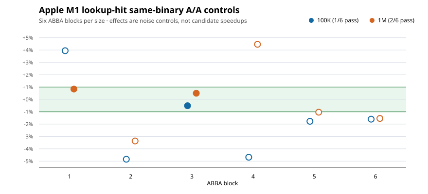

# Apple M1 lookup precision preflight — PARK

**Decision: PARK before source work.** The preregistered same-binary A/A
qualification passed only **1/6 blocks at 100K** and **2/6 at 1M**. Both
sizes require 6/6. All 48 measured operation windows lasted 564.069–768.678
ms, well above the 10 ms minimum. The failure is repeatability under this
fixed M1 schedule, not a short-timer failure. There was no candidate binary,
source edit, proposal population or candidate timing. The tree remains
unchanged.

| Members | Block effects, seeds 1/2/3/1/2/3 | Passing blocks |
|---:|---|---:|
| 100,000 | +3.9450%, −4.8445%, −0.5107%, −4.6820%, −1.7713%, −1.5989% | 1/6 |
| 1,000,000 | +0.8411%, −3.3643%, +0.5026%, +4.4661%, −1.0348%, −1.5401% | 2/6 |

These effects compare paired sides of the **same** binary, not baseline
against an optimization. Exact qualification used `abs(B−A)*100 <= A` on
integer elapsed-nanosecond sums, plus each window ≥10 ms. No block was
excluded and no threshold, count, seed, or case was changed after timing.
The independent [raw audit](results/AUDIT.json) reconstructs all 48 rows
and 12 decisions from 116 hashed stdout/stderr streams, verifies 58 serial
commands and reaped children, and matches every recorded hash. All 48 CSV
checksums passed the inherited EXP-009 lookup oracle during collection.

The [preregistered plan](PLAN.md) was pushed at `fb11830e7` before building;
the [build/calibration freeze](BUILD-FREEZE.md) and its raw evidence were
pushed at `32b0761a2` before A/A. M1 fixed operations were 7,239,383 at
100K and 2,142,437 at 1M, derived from three 200K-query observations per
size. Native and ASan/UBSan lookup smoke passed. The native binary SHA256 is
`4a9244a0ab98011763fdc507e0619636295793de78dcbc5086dceef0eeca97ef`.
The tree, adapter, and lookup harness hashes match M6's corrected baseline;
the machine and compiler differ.

The [latest M6 EXP-009 result](../EXP-009/RESULTS.md) also PARKed before
candidate work: its own 100K controls passed 6/6, but 1M passed 3/6. M1 and
M6 rows are separate and are not pooled. M1's worse control qualification
does not prove an architecture cause or refute the untested output-mode
hypothesis. It does establish that this M1 runner and frozen schedule cannot
clear the required precision gate for a 2% candidate claim. Do not repeat
this schedule unchanged or time the candidate under this failed gate.

Host: Apple M1 MacBook Air, four performance and four efficiency cores,
macOS 26.3, Apple clang 17.0.0 (clang-1700.6.3.2), C11/O3, no LTO, one
unpinned thread, default environment recorded in the command journal.
Frequency, DVFS state and full core residency were not measured. CPU
start/end identifiers changed in 15/24 100K and 20/24 1M processes; that
endpoint observation does not count migrations or establish a cause.
Tree-owned bytes and output checksums agree within every A/A block.

The required [`cpu-perf` MCP consultation](PLAN.md) was repeated after the
result. `ask` returned Linux `osnoise` tracing material, which does not
diagnose this macOS run. `check_evidence` flagged absent frequency and core
residency information for a portable performance claim and heuristically
misread the detailed ABBA method; the local exact gate and raw audit, not the
MCP heuristic, determine this PARK decision. No external benchmark numbers
were used to qualify M1.

Next meaningful work is a **new** measurement-method experiment with a
specific causal question and separately frozen controls, or an independently
qualified M6 candidate on a dedicated runner. There is no M1 source
optimization selected from this preflight. Historical M1 and M6 population
counts are unchanged.
