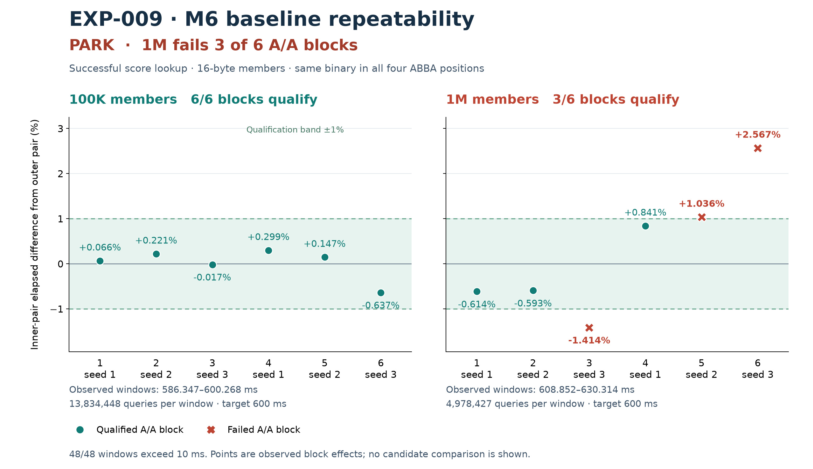

# EXP-009 — guarded M6 lookup prerequisite result

**PARK / source NONE.** Completed 2026-10-19T08:34:16.558417+00:00. All 48 fresh baseline A/A runs finish, but only 9 of 12 blocks qualify. The fixed dual-size prerequisite fails before the actual proposal population, source implementation or candidate timing. No guarded lookup optimization was tested or rejected; the idea remains unresolved.

The user authorized following up the historical M6 100K physical-slot lookup lead and publishing all checkpoints on main. The new experiment keeps both 100K and 1M primaries, uses the current corrected panic adapter, and investigates a semantic output-mode boundary. Historical −4.80% lookup results do not qualify this new baseline. No tree-size or CPU dispatch guard was added.

## Fresh measurements

Effects below compare paired sides of the **same baseline binary**, in elapsed time. They are noise controls, not optimization gains. Each row retains all six ABBA blocks in seed order 1/2/3/1/2/3. Qualification uses exact integer sums: abs(B−A)×100 ≤ A in every block and all windows ≥10ms.

| Members | Six control block effects | Qualified |
|---|---|---|
| 100,000 | +0.066263% / +0.220646% / -0.016887% / +0.299162% / +0.147094% / -0.636548% | 6/6 |
| 1,000,000 | -0.614488% / -0.593165% / -1.414059% / +0.841157% / +1.036273% / +2.567325% | 3/6 |

The failed 1M blocks are −1.414059%, +1.036273% and +2.567325%. Every 100K block qualifies. All 48 windows are **586.347–630.314 ms**; this failure is not a short-window result. Fixed baseline-calibrated counts are 13,834,448 queries at 100K and 4,978,427 at 1M. Three 200K-query observations per size select the fastest elapsed value and integer-ceiling target of 600ms; neither count caps. Counts, all 48 schedule entries and the 297-identity timing seal were committed before launch.

The A/A phase took **44.654191s wall**, with **29.029197s in operation timers**. All child processes were reaped and owned groups observed empty; all 297 frozen entries match after the phase. No retry, count adjustment, row exclusion, threshold relaxation or 100K-only relabeling follows.

[Plot reproduction and exact data](CHART.md). [All 96 raw A/A streams](bench-results/aa/public-raw-manifest.json), [48-row summary](bench-results/aa/summary.json), [fixed counts](bench-results/calibrate/counts.json), [preregistered plan](PLAN.json), [timing seal](timing-manifest.json).

## Correctness and mechanism evidence

The fresh corrected baseline completes 63 build/validation commands in 11.090947s wall. Original 43 tests pass in both native and ASan/UBSan builds. The unchanged physical oracle passes 4,160 layouts and 515,840 exact score/position/output checks per build, covering widths0..64, selected shifts/counts, both orientations, signed-zero bases and all four optional-output combinations. All 36 public hit/miss/mixed lookup smoke cases and eight expected CLI rejections pass. These are baseline validations, not future-candidate validation or complete representation/mutation guard coverage.

Independent inspection of actual fresh release code confirms the physical→logical→physical round trip on a score-lookup hit. The helper contains 142 static instructions and a 144-byte frame; ScoreRaw contains 491 instructions and a 160-byte frame. Static counts are not executed instruction counts, cycle costs or predicted gains. Read [fresh codegen review](review/FRESH-BASELINE-CODEGEN-A.md).

Both sampler controls pass exact recurrence output and actual probe-extent attribution, retaining 81/67 PCs. Fresh 100K/1M hit captures retain 83/283 observations, uncapped and above the fixed25 minimum. All observations are conserved, with aliases/import-stub/unknown limits disclosed. Profiles identify code locations; they do not establish decoder time share, causality or a guarded-candidate profile. Raw profile addresses remain locally retained with public commands, checksums and normalized observations in [profile evidence](profile-results/run/summary.json).

The source, referee, allocator and assertion options remain fixed. CPU is locally verified Apple M6, Apple Clang21, C11/O3/no LTO/frame pointers. Placement is uncontrolled; CPU endpoints/thread clocks/QoS are observations, not frequency or full residency evidence. No cause is assigned to the failed controls and no alternate metric rescues their gate.

## Review, failures and provenance

All new evidence/checkpoints are published to main. There are 125 serial journaled commands: 63 build/validation, eight profile/control+offline-map commands, six calibration commands and 48 A/A commands. The 234 non-profile stdout/stderr streams are byte-identical public copies; raw profile streams stay local under the documented profile policy.

The first invocation failed before Owner construction because the driver generated an absolute default manifest path. It launched zero native child processes and created no phase output directory. The error also exposed absolute output-identity paths. Original driver/sealer, input seal and ACK are preserved in [harness history](harness-history/launch-001-failure.json). A separate one-line relative-path correction plus versioned seal support was reviewed and committed before the first native build. The prior 41 offline controls missed this CLI integration gap; five actual-main/Owner mocked CLI cases and 158 generated path checks cover it in the revised review. No native schedule was repeated. A Git publication race left build ACKv2 unused; build ACKv3 rebinds the successfully published input seal. Inherited previous_ack fields in later ACKs describe that build authorization history, not repeated profile/calibration/A/A attempts.

Initial review/control setup failures, rejected expectations and editorial corrections remain in Git/review records. The current 69-entry input-v2 seal and 297-entry timing seal identify the actually executed revision; the original input seal is a historical record, not a claim that its old mutable file paths still match revised code.

The independent [raw integrity audit](review/FINAL-RAW-AUDIT-A.md) and [adversarial decision review](review/FINAL-DECISION-C.md) pass. The audit independently reconstructs all48rows/12gates, all250original raw-stream hashes and125serial/reaped process records; overlapping input/build/timing seals contain69/241/297entries. Lookup profiles conserve152text/210external/4unknown-target import-stub observations, separately from148sampler-control observations. The first audit draft misread a calibration annotation shape; its failure, source and corrected offline audit remain preserved. No native run was repeated. These reviews do not constitute independent candidate timing confirmation. Participants: root operator/publisher; A fresh codegen/mapper/raw audit; B driver/chart; C independent prelaunch and decision review. Roles and prior authorship are disclosed. Exact serving model/token/currency cost remains unknown; visible backend is Codex/GPT-6 family.

## Decision and next condition

No actual proposal or implementation population started because the fixed A/A prerequisite failed. This adds no completed candidate population, optimization patch or accepted source change. Historical M6 totals remain 12 populations, 0 accepted / 7 rejected / 5 parked, 36 retained patches and 15 historical validated harnesses; this new baseline harness revision/prerequisite PARK is tracked separately.

The semantic output-pointer boundary remains viable, and the redundant conversion exists in the corrected binary. Acceptance still requires a new justified measurement qualification or dedicated qualified runner, actual three independent proposals/chair and three isolated implementations, both primary gates, the complete101-case floor plus missing representation/output/mutation guards and memory checks, held-out independent confirmation, matched candidate profile and adversarial review. Do not repeat this completed schedule unchanged or turn the successful100K controls into a post-hoc single-size optimization claim.

Local native ownership is released: A/A phase finished 2026-10-19T08:34:16.558417+00:00, no further native workloads are queued for EXP-009. Final raw audit, decision review and chart inspection are complete; all evidence is published on main. The frozen README.md remains the original preregistration; STATUS.md and this result govern the current decision. The separately authorized remote ARM campaign retains its own scope and lease.
