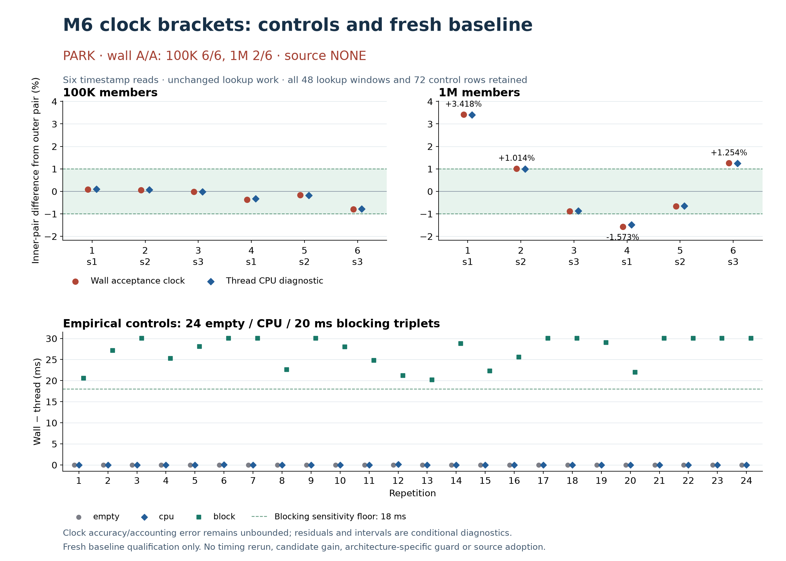

# Clock brackets implemented; fresh M6 baseline PARK

The separate lookup frontend now records w0,t0,w1 / unchanged work / w2,t1,w3,
nominal wall/thread resolutions and all original CSV fields. Native/sanitizer
correctness, independent compiled-code review and empirical blocking sensitivity
pass. **Fresh wall A/A qualifies100K6/6 and1M2/6: baseline PARK, source NONE.**
No source proposal/implementation population, candidate comparison or timing retry.

## What changed and what passed

The harness revision is published separately atc9994a3a7. Production tree/header,
allocator, hashing, assertions and original referee stay unchanged. Lookup work,
seeded fixtures, warmup and final exhaustive hit/miss checks are byte-identical to
EXP-009. New CSV appends six raw timestamps and two nominal resolutions; CPU/QoS
snapshots remain outside the bracket and profile/count hooks are prohibited.
[Mechanical diff](harness-diff.json) · [revised frontend](harness/lookup.c) ·
[clock helper](harness/clock-bracket.h) · [fixed controls](harness/controls.c).

Build phase passes85 serial commands in11.7586s, with both original43-test suites
(native and ASan/UBSan) and36 paired old/new hit/miss/mixed frontend checks across
8/16/319/320/321/1024-byte members. All exact outputs and tree-owned bytes match.
[Build journal](results/build/commands.jsonl) and [final state](results/build/status.json).
The control executable was compiled with both flags; empirical controls ran natively.

Independent static review confirms all72 emitted tree functions/16,025 instructions
and two outlined helpers match after explicit relocation handling. Actual clock IDs
are6/16/6 before the lookup work and6/16/6 after it. The two-million-step recurrence
and sleep/EINTR retry stay inside their brackets. Static equivalence is not runtime
performance equivalence; caller code and placement changed. [Codegen review](review/CODEGEN-B.md).

Eleven analyzer synthetic controls and four driver fault controls pass. Independent
pre-native review found three driver safety gaps and a model-gate issue; fixes and
initial failures are preserved before execution. PLANv1→v2 was a preregistered,
reviewed correction before ANY native work, not a response to measured rows.
It separates model inconsistency from structural/sensitivity failure, without a
chosen numerical tolerance or changed wall gate. Unused initial patch/seal rendering
and an offline test-fixture error remain in history; neither ran a benchmark.

## Empirical controls

The one fixed control process emits24 repeats of empty/CPU/20msblocking,72 rows.
Independent affine exponentiation gives checksum3294929107973101697 for the CPU
recurrence. Every checksum/order/monotonicity/sleep-sensitivity check passes; all
blocking sleep intervals exceed20ms and recorded wall−thread residuals exceed18ms.
Observed blocking residuals20.142541–30.010875ms retain all overshoots/interruptions.
The inner sleep measurement uses the SAME wall clock, not an independent reference.

Three EMPTY controls (zero-based repetitions1/12/13) have zero inner wall and margins,
but thread deltas292/250/375ns. Their conditional zero-error intervals are empty;
all three are retained as INCONCLUSIVE. No repair, exclusion or guessed accuracy
allowance. The other69 control intervals and all48 lookup intervals are nonempty
under that conditional model. Nominal resolutions are1000ns wall and42ns thread;
these do not prove accuracy or accounting-lag bounds. Lookup wall edge margins
range0–4000ns; measured margins are not a bound on total clock error.
[Raw controls](results/controls/raw/controls.stdout) · [root result](results/controls/summary.json) ·
[independently authored analyzer run by root](review/ACTUAL-CONTROLS-A.json).

## Fresh qualification: unchanged exact wall gates

Source baseline d13b3598f6e859969c764daf9982998f87233f73, current corrected adapter,
Apple M6/macOS arm64, AppleClang21.0.0 C11 -O3 -g -Wall -Wextra -Werror
-fno-omit-frame-pointer -fno-lto; unchanged allocator/assertions/hash. One lookup
thread per process, actual core residency/frequency/DVFS and effective QoS unknown.
Cases: successful public score lookup,16-byte members,100K AND1M, one fixed warmup,
six ABBA blocks each, seeds1/2/3 twice, alternating size order. Counts fixed BEFORE
measurement at13,834,448 and4,978,427 queries; no new calibration/inflation.

Qualification requires abs(Bsum−Asum)*100<=Asum in EVERY block, exact output/memory
fingerprints and every window>=10ms. All48 windows are594.536–650.797ms.
Native A/A phase completes43.77916s, every row retained. Thread comparisons remain
purely diagnostic; the +1.014038% wall failure is not rescued by its+0.987703% thread
contrast. Nothing in these rows requalifies EXP-009 or establishes a speed change
relative to its different frontend/session.

| Members | Block | Seed | Wall contrast | Thread contrast, diagnostic | Wall gate |
|---:|---:|---:|---:|---:|---|
| 100,000 | 1 | 1 | +0.091573% | +0.096925% | PASS |
| 100,000 | 2 | 2 | +0.062480% | +0.070608% | PASS |
| 100,000 | 3 | 3 | -0.025045% | -0.022035% | PASS |
| 100,000 | 4 | 1 | -0.374418% | -0.328726% | PASS |
| 100,000 | 5 | 2 | -0.170972% | -0.186500% | PASS |
| 100,000 | 6 | 3 | -0.801227% | -0.780443% | PASS |
| 1,000,000 | 1 | 1 | +3.418338% | +3.395634% | FAIL |
| 1,000,000 | 2 | 2 | +1.014038% | +0.987703% | FAIL |
| 1,000,000 | 3 | 3 | -0.891522% | -0.876173% | PASS |
| 1,000,000 | 4 | 1 | -1.573061% | -1.482852% | FAIL |
| 1,000,000 | 5 | 2 | -0.664938% | -0.645552% | PASS |
| 1,000,000 | 6 | 3 | +1.253822% | +1.238471% | FAIL |

[Full raw rows and integer sums](results/aa/summary.json) · [serial journal](results/aa/commands.jsonl) ·
[final state](results/aa/status.json) · [chart inputs/hashes](chart.json).

[Independent raw audit B](review/RAW-AUDIT-B.md) and
[final measurement-validity review C](review/FINAL-DECISION-C.md) both PASS. They
independently reconstruct every wall gate and preserve the physical-attribution
limits. B verifies all134 journal commands/268 streams and640 overlapping pins
(388 distinct paths); C independently verifies clocks/control decisions. Root
checks all12 exact sums agree and verifies the old69/297-entry EXP-009 seals remain
intact. [Final verification](final-verification.json). No new measurement is queued.

## Decision and limits

Harness instrumentation is implemented/validated, with explicitly conditional bounds.
The two-size baseline is PARK:4failed1Mcontrols, no candidate timing or source adoption.
No physical descheduling, frequency, cache, core-class or migration mechanism is
identified. No architecture-specific guard, portable gain, matched candidate profile,
full guard suite or independent candidate confirmation is claimed. A/A failures
remain visible; no rerun, filtering, source selection or gate change follows.

Actual mandatory MCP calls before implementation, with actual generated assembly,
and after native release with all raw CSV are logged in[cpu-perf/](cpu-perf/README.md),
[codegen follow-up](cpu-perf/codegen/README.md) and[results follow-up](cpu-perf/results/README.md).
The tool misclassified arm64 assembly and later our CSV as perf-counter data; its
asserted multiplexing and Intel/AMD suggestions are excluded. No counters were
collected. Retrieved LLVM/Linux documentation supplies general concepts, not a Darwin
accuracy bound. Full source bodies stay local; inputs/times/response hashes are public.
Actual participants are root (harness/driver/operator), A (independently authored
controls analyzer), B (driver/codegen/raw reviewer) and C (instrumentation/decision
reviewer). These roles are not a source proposal/implementation population. Backend
is Codex/GPT-6 family; exact serving model, measured token and currency costs are unknown.

Native reservation is released: all49 control/A/A child processes reaped, groups
empty, no owned lock, fresh known-target process check empty. [Release proof](native-release.json).
All80 input pins remain intact. Original EXP-009 and M6-METROLOGY-001 stay frozen.
Historical M6 optimization totals remain12 populations:0 accepted/7 rejected/5 parked.
This campaign adds one benchmark-harness revision, one empirical-control diagnostic
and one fresh baseline qualification; zero source populations. No upstream action.
