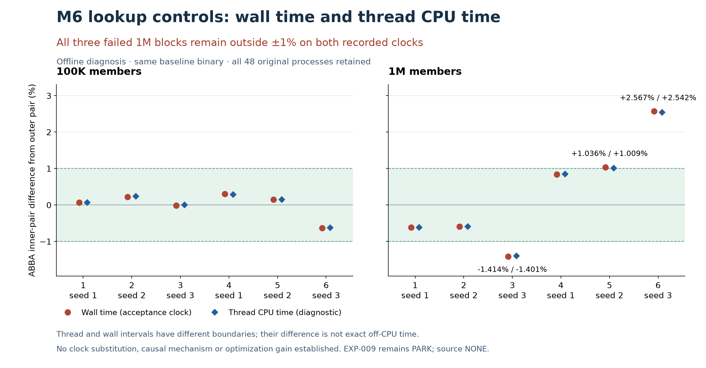

# M6-METROLOGY-001 — completed offline control diagnosis

The three failed 1M wall-clock controls also fail the recorded thread CPU-time
contrast. Their recorded wall/thread residual accounts for at most0.029 percentage
points of each wall contrast. This narrows the discrepancy; it establishes no
physical cause and does not qualify a tree optimization. **EXP-009 PARK/source NONE**.

All48 original rows,12 blocks and96 raw streams were independently reconstructed
by three actual reviewers and the controller. Both frozen seals remain intact:
69 input entries and297 timing entries. No new native build, benchmark or profile
was run; no source, referee, old threshold, row, operation count or seed changed.

| 1M block (one-based) | Seed | Original wall contrast | Thread contrast, diagnostic only | Residual contribution, wall denominator |
|---:|---:|---:|---:|---:|
| 3 | 3 | −1.414059% | −1.401384% | −0.014772 pp |
| 5 | 2 | +1.036273% | +1.008640% | +0.028978 pp |
| 6 | 3 | +2.567325% | +2.542454% | +0.028029 pp |

Both clock diagnostics give100K6/6 and1M3/6 within±1%. The acceptance rule remains
the original exact integer wall gate. Thread clock comparisons cannot rescue it.
[Exact integer sums, all rows and hashes](analysis.json) · [Reproducer](analyze.py).

Every 1M seed changes from a negative contrast on its first occurrence to a positive
contrast on its repeat. Time and preceding-size order change together; this is a
post-hoc association, not a controlled cause. Stable seed effects alone are insufficient.
Each size has10/24 different CPU endpoint pairs; all endpoints are6/7. These snapshots
cannot establish continuous residency, migration inside the timed loop or core type.
No endpoint filtering, complementary-block averaging or duration-only retry follows.

The thread interval encloses the wall interval. Wall−thread therefore combines any
off-CPU time with unmeasured boundary CPU work and accounting error; it is not exact
off-CPU duration. The smallest failed thread contrast exceeds1% by only105.605µs
per paired sum. No independently measured uncertainty bound exists at that margin.
The initial scope’s causal “falsifies” wording was corrected openly after review:
the recorded-data predicate fails, while strict descheduling-only causality remains
unresolved. Frequency, DVFS, cache state, temperature and continuous migration remain
unmeasured. Thread CPU time is not retired cycles or fixed-frequency work.

Baseline: unchanged corrected-adapter source commitd13b3598f6e859969c764daf9982998f87233f73;
Apple M6, macOS arm64; AppleClang21.0.0, C11 -O3 -g -Wall -Wextra -Werror
-fno-omit-frame-pointer -fno-lto; unchanged standalone allocator. Frozen successful
score lookup,16-byte members,6 ABBA blocks per size,seeds1/2/3 twice,13,834,448 and
4,978,427 queries per window,586–630ms wall windows. Actual frequency/effectiveQoS
and continuous core usage remain unknown. No other machine’s data qualifies this one.

[Review A: clocks](reviews/A.md), [B: schedule/endpoints](reviews/B.md),
[C: instrumentation/adversarial review](reviews/C.md), and [chair decision](selection.md)
retain the disagreements and limits. All actual MCP consultation ownership, inputs,
versions, coverage limits and response hashes are recorded in
[cpu-perf/](cpu-perf/README.md) and each reviewer’s JSON. The controller asks returned no
matched source passages; C’s later retrieval also supplies no Darwin accounting bound.
Retrieved LLVM/Linux documentation supplies method context, no M6 mechanism. Exact model/token/currency
costs are unknown; no participants or costs invented.

Decision: diagnostic complete; select NONE for a ready corrective timing method or
source hypothesis. A separate [clock-attribution design](NEXT-DIAGNOSTIC.md) targets
the missing assumption, not a baseline retry. It is unimplemented and unexecuted.
Historical M6 totals remain12 populations,0 accepted/7 rejected/5 parked; this is one
additional offline diagnostic, not another source population or hardware campaign.
No native ownership lease, queued workload, source adoption or upstream action.
