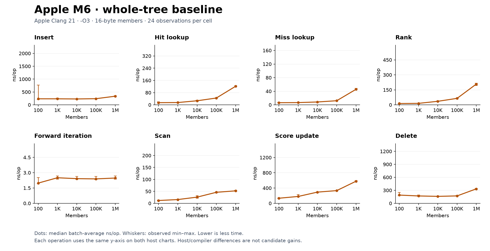
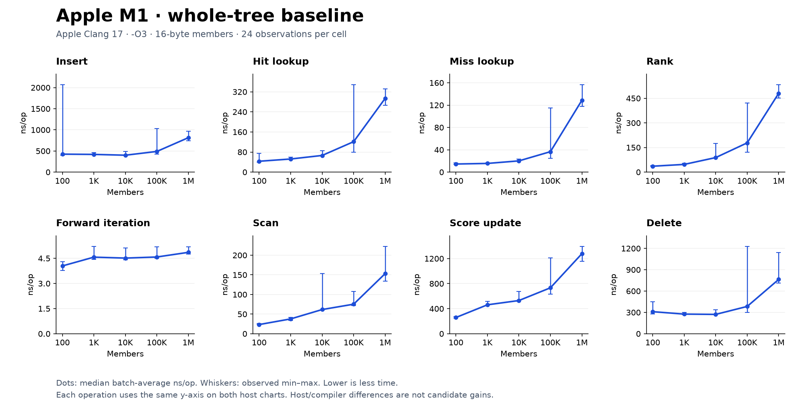

# Latest M1 and M6 baseline charts

These figures use the two overnight baselines linked from the root README, not the
earlier M1 preparation run. Each host has 40 cells: eight operations, five sizes,
24 observations per cell. Dots show median batch-average ns/op; whiskers show the
full observed min–max. Each operation has the same axis limits in both host charts.
These are host baseline costs with different compilers, not candidate gains.





[sources.json](sources.json) pins the exact published Git revisions, source paths
and SHA256 of both summary snapshots. The original host reports retain raw rows,
A/A variation and short-window checks. Both hosts remain separate; no pooled rows.
M6 uses Apple Clang 21 and M1 Apple Clang 17, both at -O3.

Reproduce from the repository root with matplotlib installed:

```sh
python3 scripts/plot-host-baselines.py experiments/NIGHT-EXPLORATION-001/baseline-charts
```

The generator verifies checksums, all 80 cells, 24 observations per cell and
min/median/max ordering before rendering. PNGs are embedded for GitHub display;
[Apple M6 SVG](apple-m6-baseline.svg) and [Apple M1 SVG](apple-m1-baseline.svg) are
also available for export. No benchmark rerun is needed to reproduce these charts.
