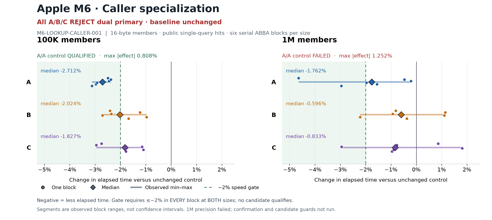

# Latest M6 caller-specialization chart



All three implementations are **REJECT dual primary / NONE**. The baseline stays
unchanged. This chart contains only M6-LOOKUP-CALLER-001's new public single-query
hit lookup screens: 16-byte binary members, 100K and1M trees, six serial ABBA blocks
per variant/size, discovery seeds1/2/3 each repeated twice. It contains no M1,
previous core-experiment or decoder-kernel results.

Each circle is one block effect, each diamond is the median of six effects, and
each segment spans their observed minimum/maximum. These are observed ranges,
not confidence intervals. Negative means less elapsed time. The solid0%line is
the unchanged control and the dashed−2%line is the declared speed gate. Passing
requires every block to reach≤−2%at BOTH sizes; a median crossing the line does
not establish a passing primary.

|Variant|100K median|100K observed range|1M median|1M observed range|Decision|
|---|---:|---:|---:|---:|---|
|A|-2.712%|-3.127..-2.378%|-1.762%|-4.645..-0.213%|REJECT dual primary|
|B|-2.024%|-2.710..-0.972%|-0.596%|-2.216..+1.142%|REJECT dual primary|
|C|-1.827%|-2.957..-1.100%|-0.833%|-2.950..+1.806%|REJECT dual primary|

The100K A/A control qualifies: maximum absolute effect0.8082514907478355%,
shortest window101.29ms. The1M A/A control fails: maximum absolute effect
1.2520863904311064%, shortest window98.011ms. Only A passes all100K primary
blocks. No variant passes every1M block. Failed1M precision further blocks fine
acceptance. No candidate guard campaign or fresh confirmation ran after these
primary-screen failures; the plot makes no adoption or broadly safe speed claim.
Measured primary owned memory is unchanged in every candidate block.

`plot-results.py` reconstructs all36 candidate and12 relevant control effects
from192 raw per-process CSV rows, using full-precision elapsed_ns/operations,
not rounded displayed ns_per_op. It checks raw CSV hashes, operation counts,
checksums, owned bytes and phase-JSON effects/medians. The effect formula is
`100*(mean candidate ns/op / mean control ns/op - 1)` within each ABBA block.
`chart-data.json` retains the exact six effects, medians/minima/maxima, all192
input-row records and raw hashes, source/candidate/patch/referee/binary hashes,
and input JSON hashes. Source provenance is pinned by freeze.json to
`e52c26c4b52c167b5ed3948eb9440f3fc2ffabaf`.

Reproduce from the repository root using the cached package environment:

```
uv run --offline --with matplotlib python experiments/NIGHT-EXPLORATION-001/runs/apple-m6-mini/20261019T013000Z/006-followup/plot-results.py
```

Matplotlib version is recorded in chart-data.json. PNG is suitable for README/chat
embedding; SVG preserves selectable text and vector output. The rendered PNG was
visually inspected: both panels, six points per variant, median/range legends,
control qualifications, sign convention, speed gate and rejection labels are
visible without clipping. Values and plotted data were checked against all raw
rows, not copied from an earlier chart.

Participant `/root/followup_proposal_b`, inherited Codex/GPT-6 family; exact serving
model, token usage and monetary cost unknown. This task produced only the assigned
plot script, PNG/SVG, chart-data JSON and this note. No source patch, benchmark,
profile, Git or shared-memory operation was performed.
