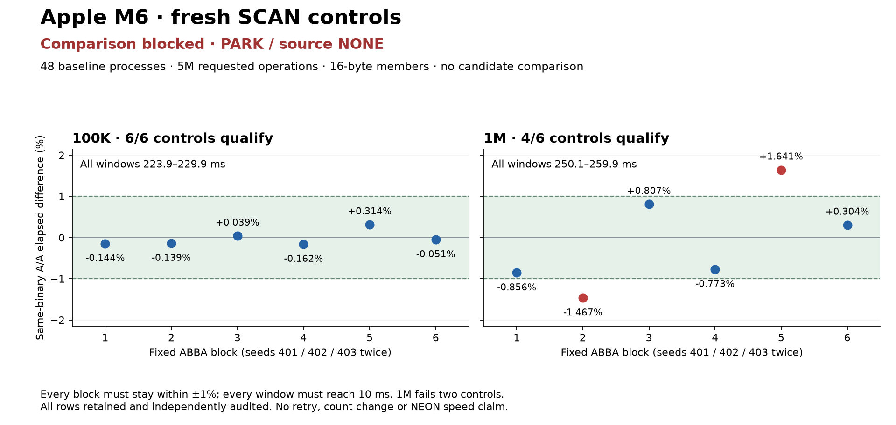

# M6 overnight evidence — 19 October 2026

Checkpoint at 06:48 UTC / 07:48 Lisbon; final reporting continues to 09:00 Lisbon. No further source experiment is queued. Experimental work has an absolute 07:15 UTC cutoff.

The tree source remains unchanged. There is no accepted tree optimization. The separate truthful `_Noreturn` correction to the always-aborting standalone panic adapter is on main; old-adapter results retain their original identity. Corrected comparisons require fresh controls.

| Evidence | Result | Practical limit |
|---|---|---|
| [M6 rank](002-rank/RESULTS.md), [update](003-update/RESULTS.md), [lookup](004-lookup/RESULTS.md), [count-one decode](005-decode/RESULTS.md), [caller specialization](006-followup/RESULTS.md) | Five night families rejected; all patches retained | Local leads fail dual-primary, guard or precision gates |
| [Fresh corrected baseline](011-contract-baseline/RESULTS.md) | 120 processes / 960 rows; correctness and raw audit pass | Only 5/40 cells fully qualify; 14 short cells among unresolved controls |
| [Matched adapter diagnostic](012-contract-diagnostic/RESULTS.md) | 576 processes; iterator median effects around −5% to −8% in selected full-output cases | No workload has jointly qualified old/new controls; all effects conditional |
| [Corrected iterator profile](013-corrected-iterator-profile/RESULTS.md) | 16 sufficient captures / 937 observations; no normal iterator frame | Sample locations are not cycles or speed savings |
| [Counter capability](016-cpu-profiler-capability/RESULTS.md) | OS denied KPC configuration | Hardware cycle weights remain unqualified; no permission change or retry |
| [Exact decoder replications](018-decoder-replications/RESULTS.md) | 20,640 serial processes / 2,662,560 batches; independent audits pass | Every window below 10 ms; private fresh bulk lead stays PARK with failed controls and guard losses |
| [Corrected member-index profile](020-member-index-profile-continuation/RESULTS.md) | 16 unique captures / 2,469 observations; every observation conserved | 10 import-stub observations retain unknown targets; original metadata failure and separate repair preserved |
| [Exact NEON replication](023-neon-replication/RESULTS.md) | Validation and independent audits pass; all 48 fresh controls retained | 1M fails two controls; PARK before candidate timing, no retry |

The last attempt qualifies all six 100K controls, but only four of six 1M controls. Failed blocks are −1.466505207% and +1.641392986%; all windows are 223.938–259.910 ms. The fixed dual-size gate blocks comparison. There is no M6 NEON speed result, and the Graviton rejections do not count as M6 measurements.

The [member-index chart](020-member-index-profile-continuation/member-index-profile.png) separates 1,422 program-text, 1,037 external-library and 10 unknown import-stub observations. Scan's inlined tag matcher contains 184 observations. Rank already vectorizes a separate child-count sum. These are code locations, not recoverable time fractions. Counter configuration remains unavailable.

The [combined decoder chart](018-decoder-replications/decoder-replications.png) retains every displayed block and marks the failed controls and short windows. The private EXP-007 A fresh median is −34.344992%, but that is not a tree speedup or accepted optimization. EXP-008's expanded original correctness matrix passes all 16,512 native/sanitizer cells.

Completed campaign counts remain 12 candidate populations (nine sequential and three actual multi-agent), 0 accepted / 7 rejected / 5 parked, 36 retained patches and 15 validated harnesses. Exact-family host replications, proposal-only NONE reviews, profiles and the adapter revision are recorded separately. No losing variant or failed capture is discarded. Exact backend model, token and currency costs remain unknown where unavailable.

M1's latest observed remote checkpoint remains 01:33 UTC at `4c48fa7ed2d8cf4f1144626276bfb2a602c63bf9`, reporting unresolved DNS. M6 milestones are public in Git; consumption by M1 is unverified. The main README overlays measured M1/M6/Intel/AMD/Graviton baselines and keeps the corrected-adapter series separate. No host's timings qualify another host.

Resume from [STATUS](STATUS.md), exact frozen source identities and recorded decisions. Do not retry completed failed schedules, adopt a private-kernel lead, carry old-adapter controls forward or treat source NONE as a missing publication. Any future source acceptance still requires qualified controls, all applicable guards and memory checks, held-out confirmation, matched profile and independent adversarial review.

The [final report review](024-final-audit/REPORT-REVIEW-A.md), [integrity audit](024-final-audit/INTEGRITY-REVIEW-B.md) and [publication audit](024-final-audit/PUBLICATION-REVIEW-C.md) pass, with the recorded editorial corrections resolved. All six source/input seals match: 1,295 overlapping pins across 879 path keys. This is not a distinct-file count or a source-acceptance review. The publication audit verifies all 15 M6 presentation assets and 105 local/Git links.

[Existing clock metadata](023-neon-replication/AA-METADATA-DIAGNOSIS.md) has a [separate independent review](024-final-audit/METADATA-REVIEW-A.md). The two failed 1M blocks have thread-clock differences of −1.440359% and +1.587803%. Twenty of 48 runs have different CPU endpoints; endpoints do not establish full residency or a migration count. The original wall-clock gate and PARK decision remain unchanged. No cause or alternative qualification metric is inferred.

Main README editorial corrections are published at `d7cf967a8`; chart bytes are unchanged. All planned native work is complete or parked. Shared status monitoring continues to the agreed 09:00 Lisbon handoff.
