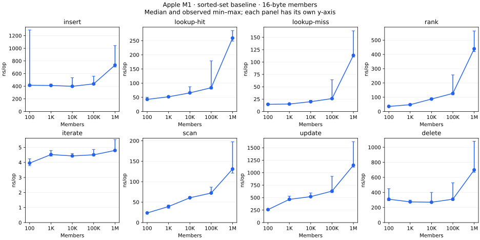
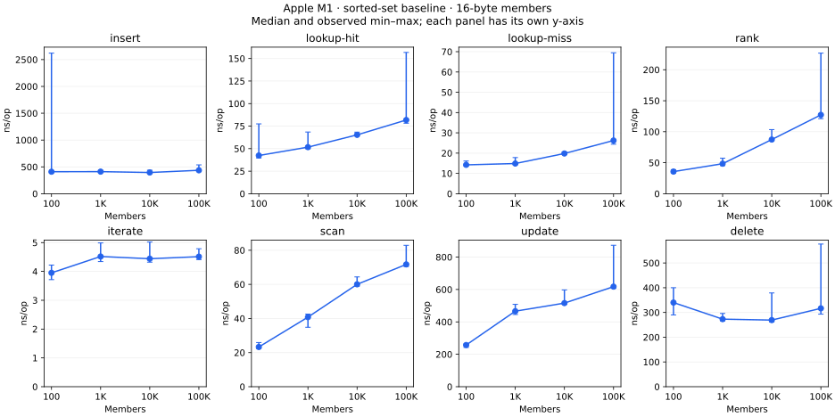

# Sorted-set size matrix

The runner now measures the standalone tree at **100, 1K, 10K, 100K and 1M members**, with
16-byte members and all eight standard operations. Each case gets its own tree.
Insert grows from empty to the stated size; delete removes that many members;
lookup, rank, iteration, scan and score update operate on a populated tree.

[Five-size extension plan](PLAN-5-SIZES.md). The original four-size data below is preserved.

## Latest five-size Apple M1 results

All **40 combinations** completed: five sizes × eight operations, 24 observations
per cell, 120 processes and 960 raw rows. Timing took **351.43 seconds**. Native and
ASan/UBSan upstream tests passed (43 each), and sanitizer benchmark checks passed
at every size, including 1M. Same CPU/compiler/flags as the original M1 run below.



[Latest table and variation](apple-m1-five-sizes/SUMMARY.md) ·
[CSV](apple-m1-five-sizes/summary.csv) · [Raw data](apple-m1-five-sizes/raw/) ·
[Manifest and validation](apple-m1-five-sizes/manifest.json)

The new 1M-member medians are approximately 259 ns/hit lookup, 439 ns/rank,
1,149 ns/update and 4.8 ns/visited member for score-only iteration. These are local
baseline observations. 39 of 40 cells have an A/A block outside ±1%; 11 cells have
a shortest window below 10 ms. No optimization or cache-miss explanation is claimed.
All raw rows remain, including slow observations. Compare M6 using this five-size
matrix and the same output contracts, not an aggregate across different operations.

## Original four-size Apple M1 results

Completed on Apple M1 / macOS 26.3, Apple Clang 17, C11 `-O3`, one unpinned thread.
All **32 size/operation combinations** are present: 96 processes, 768 CSV rows,
24 observations per cell. The timing campaign took **79.03 seconds**, excluding
builds and correctness checks. All 43 upstream tests passed in both native and
ASan/UBSan builds; the sanitizer benchmark also passed all eight cases at every size.



[Results table and variation](apple-m1/SUMMARY.md) · [CSV summary](apple-m1/summary.csv) ·
[Raw measurements](apple-m1/raw/) · [Run manifest and validation commands](apple-m1/manifest.json)

The same-binary A/A comparison exceeded 1% in at least one block for every cell;
10 cells had a shortest timing window below 10 ms. These results establish coverage
and exploratory baseline costs, not precise 1% optimization comparisons. All outliers
are retained in the tables and chart. Short insert/delete windows and iteration
batch duration are explicit follow-up measurement issues; no timing policy was
changed after seeing results.

## Run on another machine

Requires Clang, Make and Python 3. The runner builds fresh release and sanitizer
binaries, validates them, then measures serially. Use a new directory each time.

```sh
python3 scripts/run-size-matrix.py --out experiments/replications/apple-m6-mini/size-matrix --budget-seconds 600
python3 scripts/analyse-size-matrix.py experiments/replications/apple-m6-mini/size-matrix
```

For charts, install Matplotlib in a Python environment and add `--plot` to analysis:

```sh
python3 -m venv scratch/plot-env
scratch/plot-env/bin/pip install matplotlib
scratch/plot-env/bin/python scripts/analyse-size-matrix.py \
  experiments/replications/apple-m6-mini/size-matrix --plot
```

The host label is detected, not inferred from the output directory. Save M6 results
separately from the checked-in M1 data. The run manifest records source/binary
hashes, compiler flags, host, every command and the committed runner revision.

## What the numbers mean

The summary reports median **batch-average ns/op**, not individual-operation
latency percentiles. There are 24 observations per cell, covering three seeds
and six same-binary ABBA blocks. Error bars show the observed min–max range.
All results are retained, including slow runs. A/A differences measure variation
between identical code, not improvements.

Input construction and warmup are outside timing; hashing, allocation during
insert, traversal, score movement, and result consumption are inside the relevant
operation. Insert/delete time one full lifecycle per process. Small sets therefore
have short insert/delete windows: use the reported timing duration and variation
before drawing conclusions about small differences. Iteration reports ns/member;
scan reports ns/callback, including possible duplicates.

This is a synthetic single-thread baseline with repeated shuffled accesses and
integer scores. It does not cover mixed operation streams, all library APIs,
all score/member distributions, or deliberately cold caches. CPU frequency and
within-window core placement are not controlled on the local Mac.

[Fixed measurement plan](PLAN.md). No optimization candidate was tested and the
B+ tree implementation was not changed.
